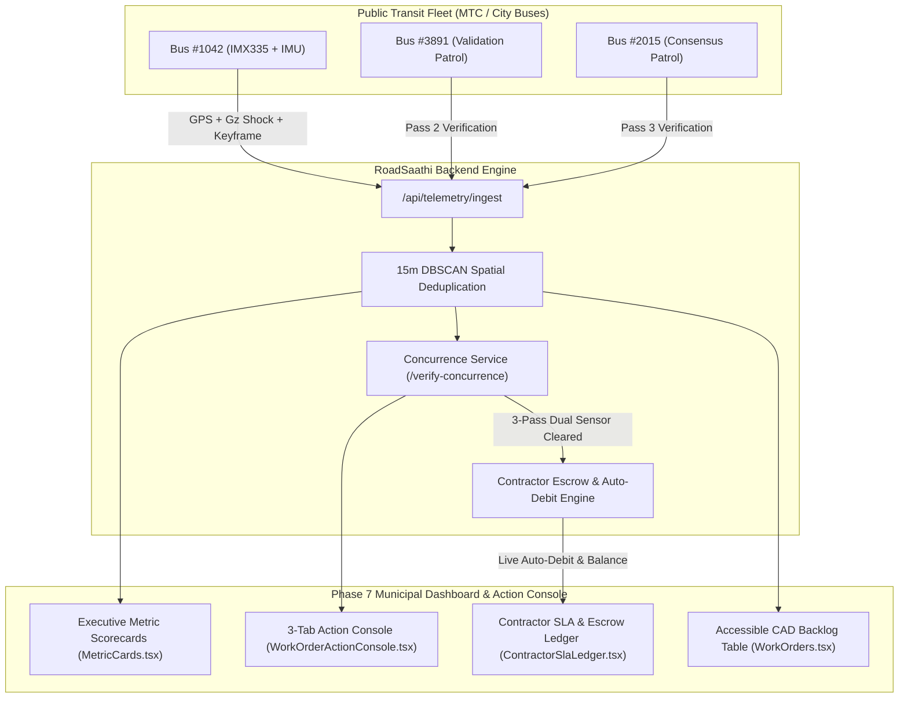
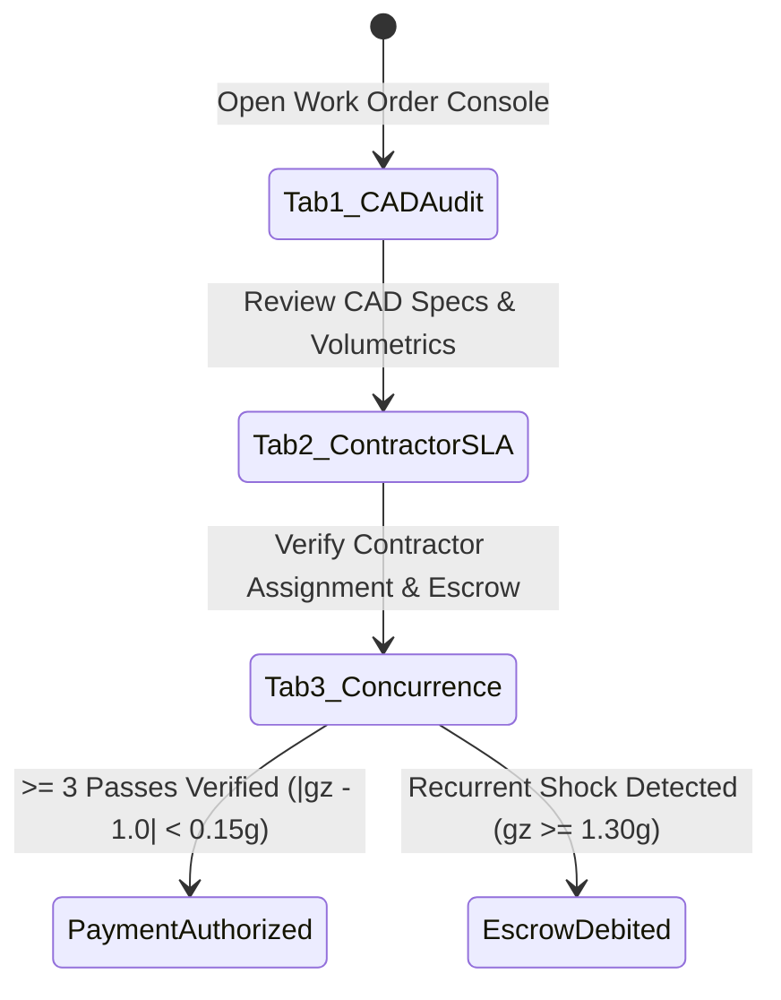

# Phase 7 Research: Municipal Dashboard, Work Orders & SLA Action Console Polish

**Phase**: `ROAD-07-municipal-dashboard-work-orders-sla-action-console-polish`  
**Requirement Reference**: `UI-03` (Executive Municipal Dashboard, Work Order Dispatch & Contractor SLA Ledger)  
**Status**: Completed Research

---

## 1. Executive Summary & Architectural Overview

Phase 7 finalizes the municipal command experience for RoadSaathi administrators, field highway engineers, and civic municipal executives (e.g. GCC / MoHUA / NHAI / PWD). It bridges edge AI perception (Phase 1 & Phase 2), backend spatial intelligence (Phase 3), and design system tokens (Phase 5) into a high-density, real-time command suite.

The phase focuses on three key UI/UX pillars:
1. **Executive KPI Scorecards & Live Fleet Health Indicators** (`MetricCards.tsx`, `CommandCenter.tsx`, `Analytics.tsx`): High-density scorecard tiles with animated SVG circular progress gauges, trend micro-badges, and tabular monospace numerals (`tabular-nums font-mono`).
2. **Interactive Contractor SLA Auditing & Payment Release Action Console** (`WorkOrderActionConsole.tsx`, `ContractorSlaLedger.tsx`): A modern 3-tab layout linking volumetric defect calculations, contractor escrow ledgers, and multi-pass transit telematics concurrence gates ($|g_z - 1.0| < 0.15g$) with a 1-click payment authorization gate.
3. **High-Density Accessible Data Tables & Export Controls** (`WorkOrders.tsx`): Sticky headers, multi-column sorting (RPI score, SLA countdown, corridor, status), instant filter chips (P0/P1/P2, Contractor, SLA State), and 1-click CSV/PDF export dockets.



---

## 2. Deep Dive: Component Breakdown & Implementation Specifications

### 2.1 Executive Scorecards & Live Fleet Health Indicators (`MetricCards.tsx`)

#### Target Locations
- `frontend/src/components/triage/MetricCards.tsx`
- Embedded in `frontend/src/pages/CommandCenter.tsx` (top HUD strip)
- Embedded in `frontend/src/pages/Analytics.tsx` (executive summary layer)

#### Core KPI Metrics Tracked
| Metric Card | Target Indicator | Micro-Badge Trend | Primary Visual Element |
| :--- | :--- | :--- | :--- |
| **Active Edge Buses** | Tier 1 perception node health & live stream status (`5 / 5 Online`) | `+0% drop • 30 FPS` | Cyan animated SVG circular gauge (100% capacity) |
| **15m DBSCAN Clusters** | Active vs resolved defect clusters (`8 Active • 42 Resolved`) | `+12.4% vs last week` | Amber animated circular gauge (% resolved) |
| **Traffic & ANPR Incidents**| Hit & Run, Speed, and School Zebra violations (`3 Active Alerts`) | `100% PCR Dispatched` | Rose circular severity pulse indicator |
| **Active PWD Work Orders** | 24h/48h SLA countdown timer status (`8 In Backlog`) | `94.2% On-Time SLA` | Blue circular SLA countdown progress ring |
| **Life-Safety Hazards** | Deep manholes (IS:1726) & flood contours (`3 Critical Hotspots`)| `Zero Incident Goal` | Purple alert ring with warning micro-pill |

#### Technical Details
- **SVG Circular Progress Gauge**: Lightweight inline SVG `circle` with `strokeDasharray` and `strokeDashoffset` animating smoothly based on ratio values.
- **Number Stability**: `font-mono tabular-nums` to eliminate jittering during real-time 5Hz telemetry streaming updates.
- **Trend Delta Micro-Pills**: Styled pills with green/amber/rose indicator arrows (`↑ 12.4% vs last week`, `↓ 4.2% breach reduction`).
- **WCAG AAA Contrast**: All foreground text and badge backgrounds maintain $\ge 7:1$ contrast ratio against both light (`#F8FAFC` / `#FFFFFF`) and dark (`#0B101D` / `#0F172A`) backgrounds.

---

### 2.2 Interactive Contractor SLA Auditing & Payment Release Action Console (`WorkOrderActionConsole.tsx`)

#### Modern 3-Tab Structure
The modal action console consolidates the former fragmented 4-tab workflow into a cohesive 3-tab lifecycle console:



#### Tab 1: CAD & Defect Audit
- **Interactive Before/After Infill Slider**: Mouse-move / touch-drag split comparison comparing original distress snapshot against post-compaction VG-30 hot-mix asphalt overlay.
- **Multi-Pass Visual Gallery Strip**: 5 selectable captured passes with vehicle badges (`Bus #04 TN-01-N-1042`), timestamps, route codes (`MTC 19B`), and vertical impact shock ($g_z$).
- **Volumetric Material Calculator**: Computes defect area ($m^2$), cavity depth ($cm$), cavity volume (liters / $m^3$), required bitumen weight ($kg$ VG-30 DBM), and Schedule of Rates (SOR 2025) cost estimate ($\text{INR}$).
- **Statutory Context**: Cites IRC:SP:20 Clause 14, MoRTH Section 3000, and DPDP Act 2023 forensic compliance hashes.

#### Tab 2: Contractor Assignment & SLA
- **Assigned Contractor Card**: Contractor name (e.g. L&T Highways Infra Ltd), CIN, Project Director, and assigned corridor link.
- **Escrow Security Deposit Pool**: Tracked deposit balance (e.g. ₹50,00,000 baseline), cumulative liquidated damages deducted, and net remaining escrow balance.
- **Debarment Risk Meter**: Risk categorization (`Low`, `Medium`, `Critical Debarment Warning`) based on breach history and chronic recurrence rate.
- **Direct Dispatch Controls**: 1-click WhatsApp formatted dispatch payload with coordinate links and cryptographic QR code generator (Zero-external-dependency pure SVG QR).

#### Tab 3: Multi-Pass Concurrence & Payment Release
- **Live 3-Pass Verification Cards**: Distinct cards representing each fleet bus pass:
  - Bus ID Badge (`BUS-TN01-1042`, `BUS-TN02-3891`, `BUS-TN09-7721`).
  - Timestamp (e.g., `Today, 07:14 IST`, `+2h 18m`, `+3h 51m`).
  - Vertical IMU $g_z$ readout (e.g., $0.98g$, $1.02g$, $0.96g$).
  - Dual Sensor Verification Badges: `Optical: SMOOTH_SURFACE` and `IMU: |gz - 1.0| < 0.15g`.
- **Payment Clearance Gate**:
  - 1-click `"Authorize Payment & Release Escrow"` CTA.
  - **State Guard**: Strictly disabled with informative tooltip when distinct qualifying passes $< 3$.
  - When distinct qualifying passes $\ge 3$, enables highlighted emerald action button calling `api.verifyWorkOrderConcurrence(orderId)` and patching cluster status to `verified_closed` / `resolved`.

---

### 2.3 Contractor Escrow & Auto-Debit Ledger (`ContractorSlaLedger.tsx`)

#### Key Capabilities
- **Summary Metric Cards**:
  - Total Tracked Security Deposits (`₹2.45 Cr Total Escrow Pool`).
  - Cumulative Penalties & Auto-Debits Deducted (`₹5.35 Lakhs Total Deductions`).
  - Active SLA Breaches (`4 Overdue Tickets under ₹500/hr Liquidated Damages`).
  - Defect Liability Warranty Compliance (`100% Monitored via Fleet Ingests`).
- **1-Click Auto-Debit Trigger**:
  - Live button calling `/api/contractors/penalties/auto-debit`.
  - Simulates recurrence shock ($g_z = 1.48g > 1.30g$) detected by patrol bus on a patched ticket.
  - Executes instant ₹25,000 deduction from contractor escrow, generates PFMS transaction reference, and displays printable treasury voucher modal.
- **Dual-View Switcher**:
  - `Performance & SLA Table`: Contractor agency list, assigned corridors, balance, on-time SLA progress bar, quality score, and breach notice generator.
  - `Auto-Debit Audit Ledger`: Itemized docket of automated Clause 14 deductions with PFMS transaction IDs, bus IDs, measured shocks, and SHA-256 evidence hashes.

---

### 2.4 High-Density Accessible Data Tables & Export Controls (`WorkOrders.tsx`)

#### Data Table Architecture
- **Sticky Header**: `sticky top-0 z-10 bg-slate-50 dark:bg-zinc-900 shadow-xs` ensuring column headers remain visible during deep scrolling.
- **Multi-Column Sorting**: Clickable column headers supporting ascending/descending sorts:
  - `RPI Score` (numeric sort)
  - `SLA Deadline / Hours` (time remaining sort)
  - `Corridor / Road Name` (alphabetical sort)
  - `Status` (workflow stage sort)
- **Quick Filter Chips**:
  - Severity: `All`, `P0 Critical`, `P1 High`, `P2 Medium`, `P3 Low`.
  - Contractor: `All Agencies`, `L&T Highways`, `GMR Urban`, `TNRDC`, `HCC`, `Chettinad`.
  - SLA State: `All`, `Active Countdown`, `Breached / Overdue`, `Verified Closed`.
- **Statutory 1-Click Export**:
  - `Export CSV`: Triggers backend `/api/work-orders/export/csv` stream with complete audit trail.
  - `Export PDF / Print Docket`: Opens browser print dialog with styled, high-contrast municipal audit docket.

---

## 3. API Contracts & Backend Integrations

### 3.1 Endpoint Mapping Summary

| Endpoint | Method | Component Consumer | Purpose |
| :--- | :--- | :--- | :--- |
| `/api/contractors/ledger` | `GET` | `ContractorSlaLedger.tsx` | Fetches contractor balance sheets, SLA %, and debarment risks |
| `/api/contractors/penalties` | `GET` | `ContractorSlaLedger.tsx` | Fetches itemized Clause 14 auto-debit dockets and PFMS references |
| `/api/contractors/penalties/auto-debit` | `POST` | `ContractorSlaLedger.tsx` | Executes instant ₹25,000 automated deduction upon recurrence |
| `/api/work-orders/{id}/verify-concurrence`| `POST` | `WorkOrderActionConsole.tsx` | Validates 3-pass dual-sensor concurrence criteria |
| `/api/work-orders/{id}/status` | `PATCH` | `WorkOrders.tsx`, `WorkOrderActionConsole.tsx` | Updates work order status with field notes & evidence URL |
| `/api/work-orders/export/csv` | `GET` | `WorkOrders.tsx` | Streams CSV export of all work orders for GCC audit compliance |
| `/api/telemetry/metrics` | `GET` | `MetricCards.tsx`, `CommandCenter.tsx` | Real-time aggregate count of buses, clusters, incidents, SLA orders |

---

## 4. Architectural Verification & Risk Analysis

### 4.1 UI Performance & Layout Shifts
- **Problem**: Real-time 5Hz sensor updates causing layout jumping or text flickering in KPI cards.
- **Mitigation**: Fixed pixel dimensions for progress circles, `tabular-nums font-mono` CSS property for all numerical readouts, and memoized calculation of metric values.

### 4.2 State Synchronization between Console & Backlog
- **Problem**: Updating a work order status in `WorkOrderActionConsole.tsx` failing to update the parent table or kanban lanes in `WorkOrders.tsx`.
- **Mitigation**: Centralized `requestStatusUpdate` callback propagating updates to both local React state and backend API, followed by instant toast notification.

### 4.3 Payment Authorization Guardrails
- **Problem**: Accidental release of contractor escrow without multi-bus physical verification.
- **Mitigation**: Hardcoded frontend and backend gate requiring $N \ge 3$ distinct transit vehicle IDs passing within tolerance $|g_z - 1.0| < 0.15g$. The CTA button remains disabled with a tooltip explicitly stating how many passes remain until unlocked.

---

## Validation Architecture

The following validation suite guarantees the integrity, accessibility, and correctness of Phase 7:

### 1. Automated Build & Typecheck
Execute the production build to ensure 100% type safety and zero Vite/TypeScript bundling errors:
```bash
npm --prefix frontend run build
```
*Expected Result*: Clean build producing optimized asset bundles with 0 TypeScript diagnostics.

### 2. Backend Regression & Unit Test Suite
Execute the pytest suite across contractor escrow, concurrence gating, and spatial clustering:
```bash
# Note: From repository root on Windows PowerShell, ensure PYTHONPATH is set to backend:
powershell -Command "$env:PYTHONPATH='backend'; pytest backend/tests/test_concurrence_gating.py backend/tests/test_contractor_ledger.py"
```
Or directly from `backend/`:
```bash
python -m pytest tests/test_concurrence_gating.py tests/test_contractor_ledger.py
```
*Expected Result*: All 17 unit tests passing with zero failures.

### 3. Component Styling & Accessibility Checklist
- [ ] **WCAG AAA Text Contrast**: Verify text-to-background contrast ratio $\ge 7:1$ for all metric values and status chips.
- [ ] **Tabular Numerals**: Confirm `tabular-nums font-mono` is applied to all counters and currency fields.
- [ ] **Sticky Table Header**: Verify `thead` remains pinned at top during vertical scrolling in `WorkOrders.tsx`.
- [ ] **Multi-Column Sorting Indicators**: Confirm up/down sort chevron icons toggle clearly on column headers.
- [ ] **SVG Animated Gauges**: Confirm SVG circular stroke animation renders smoothly without layout distortion.
- [ ] **Interactive Infill Slider**: Verify drag/mouse-move smoothly updates pre/post repair overlay in Tab 1.
- [ ] **3-Pass Concurrence Clearance Gate**: Verify "Authorize Payment" CTA is disabled when passes $< 3$ and enabled when passes $\ge 3$.

---

## RESEARCH COMPLETE
