# Phase 8 Research: Sidebar Workspace Consolidation & Global Navigation

**Phase**: `ROAD-08-sidebar-workspace-consolidation-global-navigation`  
**Requirement Mapped**: `DECLUTTER-01`  
**Milestone**: `v3.2: Sleek Minimalist Civic Cockpit & UI De-cluttering`  

---

## 1. Executive Summary & Architectural Scope

Phase 8 consolidates RoadSaathi's multi-tier navigation into **5 intuitive, high-cohesion municipal workspaces**. By grouping scattered sub-features into dedicated workspace parent modules with in-page sub-tab navigation, RoadSaathi eliminates menu clutter while preserving deep municipal capabilities (CAD triage, contractor escrow penalties, MoHUA audit logging, ANPR OCR review, and edge camera telematics).

```mermaid
flowchart TD
    subgraph GlobalNav["Global Navigation (Sidebar & BottomNav)"]
        W1["1. Command Center & Map (command)"]
        W2["2. Work Orders & SLA (work-orders)"]
        W3["3. Safety & Traffic Analytics (analytics)"]
        W4["4. Fleet Perception & Edge (fleet)"]
        W5["5. Governance & Memory (memory)"]
    end

    W1 --> S1["Live MapGIS & DBSCAN Triage"]
    W2 --> S2A["CAD Backlog Table / Kanban"]
    W2 --> S2B["Contractor SLA & Escrow Ledger"]
    W3 --> S3A["Transit Corridors & Speed"]
    W3 --> S3B["Traffic Incidents & ANPR Hub"]
    W3 --> S3C["Pedestrian & Darkspots Safety"]
    W4 --> S4A["Fleet Edge Nodes & Telemetry"]
    W4 --> S4B["Dashcam Video Ingest & Upload"]
    W5 --> S5A["Spatial Road Intelligence"]
    W5 --> S5B["Markov Deterioration & MLOps"]
    W5 --> S5C["MoHUA Statutory Audit Trail"]
```



---

## 2. The 5 Primary Consolidated Workspaces

### 1. 🗺️ Command Center & Map (`command`)
- **Core Purpose**: Central WebGIS command canvas, live pothole/defect detection feeds, DBSCAN cluster triage, and real-time civic alerts.
- **Integrated Components**:
  - `CommandCenter.tsx`: MapLibre WebGIS canvas, cluster inspect cards, and triage drawer.
  - `LiveTelemetry`: WebSocket bus positions, vertical shock ($G_z$), and active node indicators.
- **Route Key**: `command` (URL hash: `#/command`).

### 2. 📋 Work Orders & SLA (`work-orders`)
- **Core Purpose**: PWD CAD maintenance backlog, automated contractor routing, 3-pass multi-bus concurrence verification, and contractor escrow liquidated damages ledger.
- **In-Page Sub-Tabs**:
  - `[CAD Backlog]`: Accessible data table and Kanban board with multi-column sorting (RPI, SLA, Cost).
  - `[Contractor SLA Ledger]`: Penalty debit calculations, 36-month DLP escrow holdbacks, and concurrence clearance gate.
- **Route Key**: `work-orders` (URL hash: `#/work-orders`).

### 3. 📊 Safety & Traffic Analytics (`analytics`)
- **Core Purpose**: Comprehensive traffic velocity correlation, moving violation enforcement, ANPR review queue, and Vision Zero pedestrian safety audits.
- **In-Page Sub-Tabs**:
  - `[Transit Corridors]`: Dual-spline speed vs. distress ingestion rate, PCI deterioration index, and GTFS delay attribution.
  - `[Incidents & ANPR]`: Moving violations docket, ANPR OCR human-in-the-loop review queue, and VAHAN RTO queries.
  - `[Pedestrian & Darkspots]`: Vision Zero school/hospital corridor ratings (IRC:35) and night-time unlit streetlight outage logs.
- **Route Key**: `analytics` (URL hash: `#/analytics`).

### 4. 🚌 Fleet Perception & Edge (`fleet`)
- **Core Purpose**: Distributed edge fleet node management, camera streaming, IMU sensor telemetry diagnostics, and dashcam video ingest.
- **In-Page Sub-Tabs**:
  - `[Fleet Nodes]`: Live RTSP/HLS camera stream, sensor diagnostics, and vehicle roster.
  - `[Dashcam Ingest]`: Mobile dashcam capture workstation, video footage ingestion, and edge model upload.
- **Route Key**: `fleet` (URL hash: `#/fleet`).

### 5. 🛡️ Governance & Memory (`memory`)
- **Core Purpose**: Long-term spatiotemporal pavement memory, predictive Markov deterioration time machine, self-learning studio, and statutory MoHUA compliance audit trails.
- **In-Page Sub-Tabs**:
  - `[Road Intelligence]`: Arterial corridor maintenance timeline, repair durability index, and monsoon risk scoring.
  - `[Markov Deterioration & MLOps]`: IRI degradation time-machine forecasts and self-learning edge studio.
  - `[MoHUA Audit Trail]`: Cryptographic immutable logs, officer action audit dockets, and statutory PDF/CSV export.
- **Route Key**: `memory` (URL hash: `#/memory`).

---

## 3. Sub-Tab Switcher Architecture & Styling System

All 4 secondary workspaces (`WorkOrders`, `FleetNodes`, `RoadMemory`, `Analytics`) share a consistent, high-contrast, accessibility-tested sub-tab switcher token system.

### Design Tokens & CSS Classes
- **Container Bar**:
  ```tsx
  className="flex items-center gap-1.5 p-1 bg-white dark:bg-zinc-900 border border-zinc-200 dark:border-zinc-800 rounded-xl shadow-xs"
  ```
- **Active Tab Pill (Indigo Focus)**:
  ```tsx
  className="px-3.5 py-1.5 rounded-lg text-xs font-semibold bg-indigo-50 dark:bg-indigo-950/60 text-indigo-700 dark:text-indigo-300 border border-indigo-200 dark:border-indigo-800/80 shadow-xs transition-all cursor-pointer"
  ```
- **Inactive Tab Pill**:
  ```tsx
  className="px-3.5 py-1.5 rounded-lg text-xs font-medium text-slate-600 dark:text-slate-400 hover:text-slate-900 dark:hover:text-slate-100 hover:bg-slate-100 dark:hover:bg-slate-800/60 border border-transparent transition-all cursor-pointer"
  ```

### Deep Linking & URL Parameter Support
Sub-tab state synchronizes seamlessly with URL search parameters (e.g. `#/analytics?tab=incidents` or `#/fleet?tab=capture`):
```typescript
// Sub-tab query parameter parser
const getInitialSubTab = (paramName: string, defaultTab: string): string => {
  const hash = window.location.hash;
  const query = hash.split('?')[1];
  if (query) {
    const params = new URLSearchParams(query);
    const tab = params.get('tab');
    if (tab) return tab;
  }
  return defaultTab;
};
```

---

## 4. Navigation Modernization & Responsive Layouts

### 4.1 Desktop Sidebar Collapse with Floating Tooltips (`SidebarNav.tsx`)
1. **5-Item Menu Hierarchy**:
   - Clean single list containing exactly the 5 consolidated workspaces.
   - Dynamic badges for real-time counts:
     - `command`: None / Live dot.
     - `work-orders`: Open CAD clusters count (`clustersCount`).
     - `analytics`: Active incidents count (`incidentsCount`).
     - `fleet`: Online edge nodes (`fleetCount`).
     - `memory`: None.
2. **Smooth Floating Tooltips on Collapse**:
   - When `isCollapsed === true`, icons are centered with `w-[60px]`.
   - On hover, a high-contrast floating tooltip appears to the right (`left-full ml-2 z-50 whitespace-nowrap bg-zinc-900 dark:bg-zinc-100 text-white dark:text-zinc-900 text-xs px-2.5 py-1 rounded-md shadow-lg pointer-events-none`).
3. **Keyboard Shortcuts**:
   - Key `1` $\to$ `command`
   - Key `2` $\to$ `work-orders`
   - Key `3` $\to$ `analytics`
   - Key `4` $\to$ `fleet`
   - Key `5` $\to$ `memory`

### 4.2 Streamlined Mobile Bottom Bar (`BottomNav.tsx`)
1. **4 Primary Touch Targets**:
   - 🗺️ `command` (GIS Command)
   - 📋 `work-orders` (Orders)
   - 📊 `analytics` (Analytics)
   - 🚌 `fleet` (Fleet)
2. **"More" Drawer Trigger**:
   - 5th button with `MoreHorizontal` or `Layers` icon triggering a modal/drawer containing:
     - 🛡️ Governance & Road Intelligence (`memory`)
     - ⚙️ System Settings & Officer Clearance Switching
     - ⌨️ Keyboard Shortcuts & Documentation

---

## 5. Backward Compatibility & Routing Redirections

To ensure zero route regressions for bookmarked URLs, deep links, or legacy external integrations:
- `#/incidents` $\to$ Redirects to `#/analytics?tab=incidents`
- `#/capture` $\to$ Redirects to `#/fleet?tab=capture`
- `VALID_ROUTES` in `App.tsx` updated to `["command", "work-orders", "analytics", "fleet", "memory", "incidents", "capture"] as const` with automatic canonical alias resolution.

---

## 6. Officer Role Clearance Alignment (`AuthContext.tsx`)

| Officer Role | Authorized Workspaces |
|---|---|
| **State ICCC Super Admin (`admin`)** | `command`, `work-orders`, `analytics`, `fleet`, `memory` (All 5) |
| **Edge AI MLOps Director (`admin2`)** | `command`, `fleet`, `analytics`, `work-orders`, `memory` (All 5) |
| **Traffic Police (`traffic_police`)** | `command`, `analytics` (Incidents & ANPR sub-tab), `fleet` (Capture sub-tab) |
| **PWD Superintending Engineer (`pwd_engineer`)** | `command`, `work-orders`, `memory`, `fleet` (Capture sub-tab) |
| **RTO Officer (`rto_officer`)** | `command`, `analytics` (ANPR & VAHAN sub-tab) |
| **Transport Commissioner (`commissioner`)** | `command`, `analytics`, `memory` (Executive Oversight) |

---

## Validation Architecture

The implementation will be verified through automated build checks and an exhaustive visual/routing checklist.

### 1. Automated Build Verification
```bash
npm --prefix frontend run build
```
- **Target**: Zero TypeScript compilation errors (`tsc`), zero Vite bundle errors, and clean asset generation under `dist/`.

### 2. Routing & Rendering Checklist
- [ ] **Workspace 1 (Command Map)**: Loads WebGIS map, DBSCAN clusters, live telemetry status, and cluster inspector without 404s.
- [ ] **Workspace 2 (Work Orders)**: Sub-tab switcher smoothly toggles between `[CAD Backlog]` (Table/Kanban) and `[Contractor SLA Ledger]` without page reload.
- [ ] **Workspace 3 (Analytics)**: Sub-tab switcher toggles between `[Transit Corridors]`, `[Incidents & ANPR]`, and `[Pedestrian & Darkspots]`.
- [ ] **Workspace 4 (Fleet Edge)**: Sub-tab switcher toggles between `[Fleet Nodes]` and `[Dashcam Ingest]`.
- [ ] **Workspace 5 (Governance)**: Sub-tab switcher toggles between `[Road Intelligence]`, `[Markov Deterioration]`, and `[MoHUA Audit Trail]`.
- [ ] **Sidebar Collapse**: Toggling desktop collapse mode displays floating tooltips on hover and preserves active indicator styling.
- [ ] **Mobile BottomNav**: Displays 4 primary touch targets + "More" drawer trigger on viewports `< 768px`.
- [ ] **Keyboard Navigation**: Keys `1` through `5` navigate instantly to the corresponding consolidated workspace.
- [ ] **Contrast Compliance**: Active indigo pills pass WCAG AAA ($\ge 7:1$) contrast requirements in Light, Dark, and Cyber-Edge modes.

---

## Conclusion
The architectural investigation is complete. Consolidation into 5 core workspaces with standardized indigo sub-tab switchers, backward-compatible route aliases, and mobile drawer controls will streamline RoadSaathi's interface while maintaining full municipal intelligence capabilities.

## RESEARCH COMPLETE
