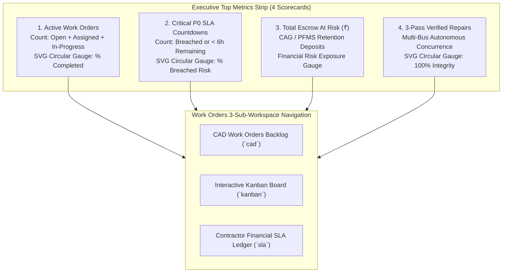

# Phase 11 Research: Work Orders Cockpit & Contractor Operations Overhaul

**Phase:** `ROAD-11-work-orders-cockpit-contractor-operations-overhaul`  
**Milestone:** `v3.3`  
**Requirements Covered:** `WO-01`, `WO-02`, `WO-03`  
**Date:** 2026-10-07  

---

## 1. Executive Summary & Objectives

Phase 11 transforms the municipal Work Orders and Contractor SLA operations in RoadSaathi from standard management lists into an executive, high-contrast, data-dense **Municipal Command Cockpit**. RoadSaathi's multi-bus perception engine autonomously detects roadway distress, calculates volumetric asphalt requirements, and tracks statutory contractor liability under IRC:SP:20 and MoRTH Clause 108.4.

This phase overhauls the frontend user experience across the three core sub-workspaces:
1. **CAD Work Orders Backlog (`cad`)**: Compact, high-whitespace data cockpit with monospace tabular numbers, subtle borders, sticky sorting headers, and clustered action triggers (`Inspect`, `Release Escrow`, `Dispatch`).
2. **Modern Interactive Kanban Board (`kanban`)**: High-contrast 4-column workflow (`Assigned`, `In Progress`, `Resolved`, `Verified Closed`) with defect image thumbnails, live SLA countdown timer progress rings, contractor agency badges, and statutory concurrence chips.
3. **Contractor Financial SLA Ledger (`sla`)**: Elevated contractor escrow guarantee tracking, Clause 14 autonomous debit settlement engine with printable PFMS vouchers, and contractor debarment risk meters.
4. **Slide-Over Progressive Disclosure Drawer**: Seamless invocation of `WorkOrderActionConsole.tsx` across both CAD table rows and Kanban cards without full-page navigation.

---

## 2. Existing Codebase Analysis

### 2.1 File Map & Component Responsibilities

| File Path | Role & Architecture | Key State & Props |
|---|---|---|
| `frontend/src/pages/WorkOrders.tsx` | Main Work Orders workspace container; hosts top navigation pills, filter strips, CAD table, Kanban board, and modal orchestrations. | `clusters: HazardCluster[]`, `onUpdateStatus`, `activeTab` (`'cad' \| 'kanban' \| 'sla'`), `search`, `statusFilter`, `severityFilter`, `contractorFilter`, `sortField`, `sortDirection`, `currentPage`. |
| `frontend/src/components/workorders/ContractorSlaLedger.tsx` | Contractor SLA performance & financial ledger; tracks escrow bonds, Clause 14 auto-debits, liquidated damages, and PFMS payment vouchers. | `contractors: ContractorAgency[]`, `autoDebits: AutoDebitRecord[]`, `activeModal` (`'penalty_notice' \| 'completion_cert' \| 'auto_debit_voucher'`), `activeViewTab` (`'sla_table' \| 'auto_debit_ledger'`). |
| `frontend/src/components/workorders/WorkOrderActionConsole.tsx` | Slide-over drawer with 3 tabbed inspection consoles: CAD defect audit (before/after slider), Contractor assignment & SLA (WhatsApp dispatch), and Multi-pass concurrence payment release. | `isOpen: boolean`, `cluster: HazardCluster \| null`, `initialTab: WorkOrderConsoleTab`, `onAutoClose`, `onUpdateStatus`. |
| `frontend/src/components/modals/RoadMeshVisualizerModal.tsx` | 3D surface depth mesh visualizer powered by Three.js, measuring pothole depth, volumetric asphalt (liters/kg), sensor Gz shock, and IRI score. | `isOpen`, `hazardId`, `depthCm`, `areaM2`, `volumeLiters`, `costInr`, `sensorGz`, `isRoadSurfaceDefect()` filter guard. |

### 2.2 Current Implementation Analysis & Identification of Gaps

#### Gaps in Executive Metrics Strip (`WorkOrders.tsx`)
- **Current State:** Lines 644–688 implement 4 basic summary boxes (`Total Work Orders`, `Pending / Open`, `In Progress`, `Est. Repair Budget`) rendered exclusively inside the `cad` tab. No circular gauges or live SLA risk indicators exist.
- **Required State (WO-01, D-01):**
  - **Active Work Orders**: Count of active orders (`open + assigned + in_progress`) with completion ratio gauge.
  - **Critical P0 SLA Breaches / Countdowns**: Count of orders within 6h of breach or breached, with animated SVG circular countdown gauge.
  - **Total Escrow At Risk (₹)**: CAG / PFMS contractor retention deposits at stake (₹) across active non-closed defects under Clause 14.
  - **3-Pass Verified Repairs**: Count of orders verified closed by multi-bus sensor consensus, with 100% verification circular ring.
  - Placement: Positioned at the top of the workspace so executive visibility is maintained across CAD and Kanban views.

#### Gaps in CAD Backlog Table (`WorkOrders.tsx`)
- **Current State:** Table cells use varying padding (`py-3 px-4` in headers, `py-3 px-4` in data rows, `py-2.5 px-3` only on actions). Borders use `zinc-200 dark:zinc-800`.
- **Required State (WO-01, D-02):**
  - Standardized compact cell padding: `py-2.5 px-3` across all `<th>` and `<td>`.
  - Subtle borders: `border-slate-200 dark:border-slate-800`.
  - Strict monospace tabular numbers: `font-mono tabular-nums text-xs` for ticket codes, RPI scores, costs, and SLA countdowns.
  - High-contrast severity pills: P0 Critical (`rose-500/20 text-rose-700 dark:text-rose-300 border-rose-300`), P1 High (`amber-500/20 text-amber-700 dark:text-amber-300 border-amber-300`), P2 Medium (`slate-200 text-slate-700 dark:text-slate-300 border-slate-300`).
  - Action button cluster: Compact grouping of `Inspect` (CAD audit drawer + 3D depth mesh button for road surface defects), `Release Escrow` (3-pass concurrence gate), and `Dispatch` (instant WhatsApp/SMS notice).

#### Gaps in Kanban Board (`WorkOrders.tsx`)
- **Current State:** Kanban lanes (lines 388–568) display plain text cards with basic borders, no defect images, no live SLA countdown progress rings, and no direct integration into the `WorkOrderActionConsole` drawer.
- **Required State (WO-02, D-02):**
  - 4 high-contrast columns: `Assigned`, `In Progress`, `Resolved`, `Verified Closed`.
  - Card redesign:
    * Defect image thumbnail (with aspect ratio lock and fallback placeholder).
    * Circular SVG SLA timer countdown ring (color-coded: green for >12h, amber for 6–12h, rose for <6h or breached).
    * Contractor agency badge with corridor tag.
    * Statutory concurrence status chip (`3-Pass Pending`, `Concurrence Verified`, `MoHUA Locked`).
    * Card quick actions: Direct triggers for `Inspect` (opens CAD drawer), `Dispatch` (opens WhatsApp dispatch console), and `Release Escrow` (opens 3-pass gate).
    * Smooth column progression buttons or 1-click status transitions.

#### Gaps in Contractor Financial SLA Ledger (`ContractorSlaLedger.tsx`)
- **Current State:** Functional ledger with Clause 14 auto-debit and 3 modals, but cards and risk metrics lack high-contrast visual elevation.
- **Required State (WO-03, D-02):**
  - Elevated escrow security deposit summary: Display gross bank guarantee bonds, penalties deducted under Clause 14, and net available balance with visual health bars.
  - Contractor Debarment Risk Meter: Visual risk level badges (`Low` green, `Medium` amber, `Critical Debarment Warning` rose with animated alert) based on breach count and SLA on-time percentage.
  - Clause 14 Auto-Debit trigger: Polished interactive execution calling `/api/contractors/penalties/auto-debit` with realistic telematics payload (measured Gz shock, bus node ID), generating a printable PFMS settlement voucher.
  - Dual-view toggle: Clean switch between Performance SLA Table and Auto-Debit Audit Docket.

---

## 3. Technical Specifications & Architectural Patterns

### 3.1 Executive Top Metrics Strip Architecture



#### Animated SVG Circular Gauge Implementation
To maintain zero external bundle bloat and sub-millisecond render times, circular gauges will be implemented using pure scalable SVG:

```tsx
interface SvgGaugeProps {
  percentage: number; // 0 to 100
  strokeColor: string; // Tailwind stroke class or hex
  trackColor?: string;
  size?: number;
  strokeWidth?: number;
  children?: React.ReactNode;
}

export const SvgGauge: React.FC<SvgGaugeProps> = ({
  percentage,
  strokeColor,
  trackColor = "stroke-slate-200 dark:stroke-slate-800",
  size = 48,
  strokeWidth = 4,
  children
}) => {
  const radius = (size - strokeWidth) / 2;
  const circumference = 2 * Math.PI * radius;
  const strokeDashoffset = circumference - (Math.min(100, Math.max(0, percentage)) / 100) * circumference;

  return (
    <div className="relative inline-flex items-center justify-center" style={{ width: size, height: size }}>
      <svg className="w-full h-full -rotate-90 transform" viewBox={`0 0 ${size} ${size}`}>
        <circle
          cx={size / 2}
          cy={size / 2}
          r={radius}
          className={`${trackColor} fill-transparent`}
          strokeWidth={strokeWidth}
        />
        <circle
          cx={size / 2}
          cy={size / 2}
          r={radius}
          className={`${strokeColor} fill-transparent transition-all duration-700 ease-out`}
          strokeWidth={strokeWidth}
          strokeDasharray={circumference}
          strokeDashoffset={strokeDashoffset}
          strokeLinecap="round"
        />
      </svg>
      {children && <div className="absolute inset-0 flex items-center justify-center">{children}</div>}
    </div>
  );
};
```

### 3.2 High-Contrast Kanban Card Architecture

Each Kanban card must encapsulate:
1. **Defect Image Thumbnail**: 48px square or full-width 80px preview with error fallback to `/evidence/bus_pass_1_detect.jpg`.
2. **Live SLA Countdown Timer Ring**: Mini SVG gauge (size 28px) displaying time elapsed/remaining:
   - Green (`stroke-emerald-500`): SLA healthy (>12h remaining).
   - Amber (`stroke-amber-500`): SLA warning (6–12h remaining).
   - Rose (`stroke-rose-500`): SLA critical (<6h remaining or breached).
3. **Agency & Statutory Badges**:
   - Agency badge: `font-mono text-[10px]` with contractor code (e.g., `L&T`, `GMR`, `HCC`).
   - Statutory concurrence chip: `MultiBusTruthBadge` or status pill (e.g., `3-Pass Verified` vs `1-Pass Pending`).
4. **Action Cluster**:
   - `Inspect`: Opens `WorkOrderActionConsole` drawer in `cad_audit` tab.
   - `Dispatch`: Opens `WorkOrderActionConsole` drawer in `contractor_sla` tab.
   - `Release Escrow`: Opens `WorkOrderActionConsole` drawer in `concurrence_release` tab.
   - Quick column move buttons: One-click status advancement (`Assigned` -> `In Progress` -> `Resolved` -> `Verified Closed`).

### 3.3 Contractor Financial SLA Ledger Deep Polish

#### 1. Escrow Guarantee Accounting
- **Tracked Bank Guarantee Bonds**: Total ₹Cr held across all 5 municipal contractors under MoRTH Clause 108.4.
- **Clause 14 Deductions**: Total ₹Lakhs autonomously debited for failed patches upon recurrent sensor shock ($G_z \ge 1.30g$).
- **Net Available Escrow**: Real-time remaining balance with color-coded safety margins.

#### 2. Debarment Risk Meter
Contractors exceeding breach thresholds trigger formal statutory debarment warnings:
- **Low Risk** (<2 breaches, >90% SLA): Green indicator.
- **Medium Risk** (2–3 breaches, 75–90% SLA): Amber indicator.
- **Critical Debarment Warning** (>3 breaches or <75% SLA): Pulsing rose indicator with notice draft generation.

#### 3. PFMS Payment & Auto-Debit Settlement Voucher
- Full-page printable treasury voucher conforming to standard Public Financial Management System (PFMS) layout.
- Cryptographic evidence stamp with SHA-256 hash.
- Patrol bus node telemetry record (accelerometer peak $G_z$, timestamp, corridor GPS).

---

## 4. Work Order Slide-Over Progressive Disclosure Drawer

The `WorkOrderActionConsole.tsx` component is already built with 3 robust tabs:
1. `cad_audit`: Interactive before/after split slider, volumetric asphalt calculator ($V = A \times D$), bitumen weight (kg), and standard SOR cost.
2. `contractor_sla`: Contractor agency contact details, phone dialer, and WhatsApp/SMS template dispatch payload generator with encrypted deep link.
3. `concurrence_release`: Statutory 3-pass multi-bus verification ledger, accelerometer shock check ($G_z < 1.15g$), and CAG/PFMS payment voucher authorization.

**Integration Requirement:** Both the CAD Backlog table action cluster and the modernized Kanban cards will wire directly to `openConsole(cluster, tab)` to trigger this slide-over drawer smoothly without losing user scroll position or filter state.

---

## 5. Validation Architecture

To ensure 100% backward compatibility, zero regressions across the 34 passing backend tests, and error-free TypeScript compilation, the validation architecture specifies the following verification gates:

### 5.1 Automated Build Command
```powershell
npm --prefix frontend run build
```
- **Requirements:** 0 TypeScript compiler errors, 0 Vite build errors, output bundle emitted cleanly in `frontend/dist/`.

### 5.2 Automated Backend Regression Test Suite
```powershell
pytest -o pythonpath=backend backend/tests/test_concurrence_gating.py backend/tests/test_contractor_ledger.py backend/tests/test_explainable_webgis.py backend/tests/test_dual_engine.py backend/tests/test_spatial.py -q
```
- **Requirements:** All 34 tests must pass with 100% pass rate.
  - `test_concurrence_gating.py`: Verifies multi-bus pass concurrence gates, IMU shock threshold gating, and autonomous closure rules.
  - `test_contractor_ledger.py`: Verifies IRC:SP:20 Clause 14 auto-debit calculation, penalty holdback accounting, and escrow balance integrity.
  - `test_explainable_webgis.py`: Verifies RPI statutory factor recalculation and GIS presentation APIs.
  - `test_dual_engine.py`: Verifies SQLite WAL and PostgreSQL compatibility.
  - `test_spatial.py`: Verifies PostGIS DBSCAN spatial clustering and hazard deduplication.

### 5.3 Manual Interactive Test Checklist
1. **Executive Top Metrics Strip**: Verify all 4 cards render SVG gauges with smooth stroke animations; verify counts update dynamically as filters or statuses change.
2. **CAD Backlog Table**:
   - Verify compact cell padding (`py-2.5 px-3`) and subtle borders (`border-slate-200 dark:border-slate-800`).
   - Verify monospace tabular figures on Ticket ID, RPI, Cost, and SLA.
   - Click `Inspect` button: verify `WorkOrderActionConsole` slide-over opens to `cad_audit`.
   - Click `3D Box` button: verify `RoadMeshVisualizerModal` displays 3D Three.js mesh for road surface defects.
   - Click `Release Escrow`: verify drawer opens to `concurrence_release`.
   - Click `Dispatch`: verify drawer opens to `contractor_sla`.
   - Test multi-column sorting on Ticket, RPI, Cost, SLA, and Status.
   - Test filter chips (Severity, Agency, SLA).
   - Test CSV export button triggers download.
3. **Modern Kanban Board**:
   - Switch to `kanban` tab.
   - Verify 4 columns (`Assigned`, `In Progress`, `Resolved`, `Verified Closed`).
   - Verify cards show defect image thumbnails, live SLA countdown timer rings, and agency tags.
   - Click quick advancement button to move ticket to next status and observe toast notification and column count update.
   - Click card `Inspect` / `Dispatch` to verify drawer slide-over triggers.
4. **Contractor Financial SLA Ledger**:
   - Switch to `sla` tab.
   - Verify gross bank guarantee, penalties deducted, and net balance scorecards.
   - Verify HCC displays `Critical Debarment Warning` meter.
   - Click `⚡ Trigger Clause 14 Auto-Debit Demo`: verify simulated shock $G_z = 1.48g$ debits ₹25,000 from HCC escrow and automatically displays the printable PFMS voucher modal.
   - Toggle between `Performance Table` and `Auto-Debit Ledger` views.

---

## 6. Implementation Plan Preview

The overhaul will be executed cleanly in a single comprehensive plan:
- **Task 1:** Redesign `WorkOrders.tsx` with Top Executive Metrics Strip (4 scorecards with SVG gauges), compact CAD Backlog Table (`py-2.5 px-3`, monospace tabular numbers, action cluster), and modernized High-Contrast Kanban Board (image thumbnails, timer rings, agency tags, direct drawer triggers).
- **Task 2:** Polish `ContractorSlaLedger.tsx` with elevated escrow guarantee scorecards, contractor debarment risk meters, Clause 14 auto-debit triggers, and PFMS payment voucher dockets.
- **Task 3:** Validate with `npm --prefix frontend run build` and run the full 34-test backend regression test suite.

---

## RESEARCH COMPLETE
