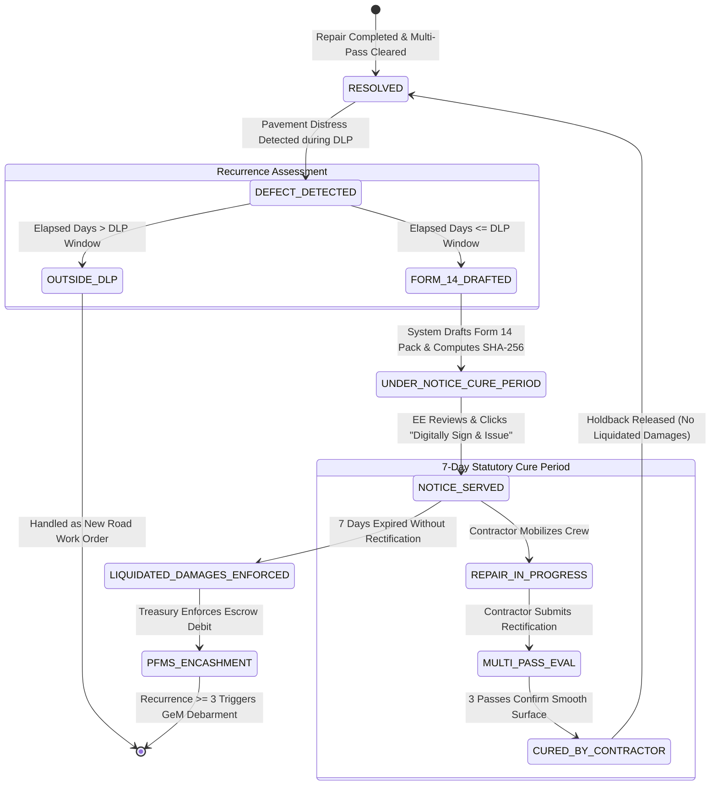

# Phase 13: Municipal Statutory Show-Cause & Relaxed Multi-Pass Gating — Technical Research

**Phase Code:** `ROAD-13-municipal-statutory-show-cause-relaxed-multi-pass-gating`  
**Milestone:** `v4.0`  
**Status:** In Progress / Research Phase  
**Author:** Custom Phase Technical Researcher (RoadSaathi)  
**Requirements Covered:** `STATUTE-01`, `STATUTE-02`  
**Dependencies:** Phase 12 (Telematics Physics & Spatial Calibration)

---

## Executive Summary

Phase 13 transitions RoadSaathi's contractor penalty enforcement and post-repair clearance mechanisms from legally fragile automated actions into an incontestable, legally compliant municipal statutory workflow grounded in Indian administrative, contractual, and evidence law.

Prior to Phase 13, the platform utilized an autonomous unilateral "Auto-Debit" mechanism: when transit telemetry detected recurrent vertical shocks ($G_z \ge 1.30g$) over a previously repaired pothole, the system immediately debited the contractor's security deposit balance and generated a mock PFMS voucher. In municipal and legal reality, **unilateral escrow debit without prior notice and reasonable opportunity to cure is legally indefensible**:
1. **Arbitration & Constitutional Law**: Under Sections 73 and 74 of the Indian Contract Act 1872, the Arbitration and Conciliation Act 1996, and basic principles of natural justice (*audi alteram partem*), contractors are entitled to formal notice of alleged default and a mandatory cure period. Arbitral tribunals grant immediate stays and injunctions against unilateral bank guarantee (BG) encashment absent statutory show-cause notice.
2. **Bharatiya Sakshya Adhiniyam 2023 (BSA 2023)**: Automated digital data cannot be used to penalize contractors or defend municipal actions unless certified as an admissible electronic record under Section 63 of BSA 2023 (formerly Section 65B of the Indian Evidence Act 1872). A proper evidentiary pack with SHA-256 telemetry provenance and Executive Engineer (EE) digital signature is legally mandatory.
3. **Transit Corridor Starvation**: Requiring 3 *distinct vehicle registration IDs* (`bus_id`) within 48 hours caused severe "route starvation" on single-bus corridors (e.g., MTC Route 570 or 19B off-peak loops), locking validly completed repairs into perpetual `AWAITING_CONCURRENCE` status.
4. **Physical Axle Collision Requirement**: Requiring physical wheel impact shock ($G_z$) to clear a repair failed to recognize defensive driving: when bus drivers see a fresh, smooth asphalt patch, they naturally maneuver or straddle the repair rather than intentionally driving 12-ton bus axles into it.

Phase 13 resolves these vulnerabilities by:
1. Replacing unilateral "Auto-Debit" with a **Two-Stage Form 14 Show-Cause Notice Pack** with Executive Engineer (EE) digital sign-off, cryptographic Section 63/65B BSA 2023 certificate, and a 7-day statutory cure window before liquidated damages are enforced.
2. Implementing **Contract Package DLP Tiers** supporting dynamic Defect Liability Periods (12 months for routine bituminous overlay, 36 months for arterial DBM+BC, and 60 months for rigid concrete/PQC).
3. Relaxing multi-pass concurrence to **Trip-Windowed Gating** (3 passes within 48h from distinct vehicles OR the same vehicle on trips separated by $\ge 2$ hours / 7,200 seconds).
4. Establishing **Optical Clearance Dominance**, allowing verified clearance when windshield cameras confirm smooth asphalt without requiring physical wheel collisions, while retaining severe normalized shock ($G_{norm} \ge 0.35$) as an immediate failure trigger.
5. Modernizing all UI terminology and workflows across `WorkOrders.tsx`, `ContractorSlaLedger.tsx`, and `WorkOrderActionConsole.tsx`.

---

## 1. Section 65B BSA 2023 Statutory Show-Cause Notice Pack (STATUTE-01)

### 1.1 Legal Framework & Statutory Enforceability

Under standard Indian public works contract templates (MoRTH Standard Specifications for Road and Bridge Works 5th Revision, MoHUA Model RFP for Urban Road Works, CPWD Works Manual 2022, and Tamil Nadu Urban Development Fund concession agreements), contractor security deposits and performance bank guarantees are governed by strict dispute covenants:

```
┌────────────────────────────────────────────────────────────────────────┐
│                   MUNICIPAL LEGAL REQUISITES MAP                       │
├───────────────────────────────┬────────────────────────────────────────┤
│ Statute / Code                │ Legal Mandate                          │
├───────────────────────────────┼────────────────────────────────────────┤
│ Indian Contract Act 1872,     │ Liquidated damages require prior       │
│ Sections 73 & 74              │ demonstration of unrectified breach;   │
│                               │ unilateral deductions without show-    │
│                               │ cause notice constitute unlawful levy. │
├───────────────────────────────┼────────────────────────────────────────┤
│ Bharatiya Sakshya Adhiniyam   │ Electronic records (sensor logs, GPS,  │
│ 2023 (BSA 2023), Section 63   │ dashcam video) require SHA-256 hash,   │
│ (Section 65B IEA 1872)        │ device calibration record, and signed  │
│                               │ certificate from officer in custody.   │
├───────────────────────────────┼────────────────────────────────────────┤
│ IRC:SP:20 Clause 14 &         │ Form 14 Show-Cause Notice must specify │
│ MoRTH Section 3000            │ defect location, chainage, failure     │
│                               │ severity, and grant 7-day cure window. │
├───────────────────────────────┼────────────────────────────────────────┤
│ Arbitration & Conciliation    │ Failure to follow statutory notice     │
│ Act 1996, Section 9           │ allows contractor to obtain interim    │
│                               │ injunction staying bank encashment.    │
└───────────────────────────────┴────────────────────────────────────────┘
```

Unilateral automated bank deductions ("Auto-Debit") fail every judicial test. By contrast, an automated **Form 14 Show-Cause Evidentiary Pack** issued under Executive Engineer signature is legally incontestable in municipal arbitration.

### 1.2 Form 14 Notice Pack Data Specification

The statutory Form 14 evidentiary pack is composed of 8 cryptographic and forensic components:

```
╔═════════════════════════════════════════════════════════════════════════════════╗
║          FORM 14: MUNICIPAL STATUTORY SHOW-CAUSE NOTICE PACK                     ║
║          Under IRC:SP:20 Clause 14.2 & Section 63 BSA 2023                     ║
╠═════════════════════════════════════════════════════════════════════════════════╣
║ 1. Notice Docket Number:       FORM-14/DLP/{YYYY}/{CLUSTER_CODE}                ║
║ 2. Contractor Addressee:       Agency Name, Corporate CIN, MD/Director Name     ║
║ 3. Contract Package & DLP:     Corridor Name, Road Type, DLP Tier (12/36/60 mo) ║
║ 4. Forensic Telemetry Provenance:                                               ║
║    - Verifying Fleet Vehicle:  Bus Registration ID (e.g., BUS-TN01-1042)        ║
║    - Kinematic Parameters:     Measured Velocity (v), Raw Gz, Normalized Gnorm  ║
║    - Optical Classification:   Cavity Area (m²), Depth (cm), Confidence (%)     ║
║    - GPS Timestamped Fix:      Lat/Lng within 15m Corridor, NavIC Synchronized  ║
║ 5. Forensic Visual Triad:                                                      ║
║    - Frame A: Pre-Repair Cavity                                                 ║
║    - Frame B: Post-Compaction Verified Repair                                   ║
║    - Frame C: Recurrent Distress Detected during Active DLP                     ║
║ 6. Tiered Liquidated Damages:  ₹25k (1st) | ₹50k (2nd) | ₹100k + GeM (3rd+)     ║
║ 7. Statutory Cure Window:      Served Date (t0) to Cure Deadline (t0 + 7 Days)  ║
║ 8. Section 63 / 65B BSA Certificate:                                            ║
║    - Hash Algorithm:           SHA-256 (cin:cluster:amount:timestamp:telemetry) ║
║    - Custodian Declaration:    Device functioning under regular patrol route    ║
║    - Digital Signature Stamp:  Executive Engineer (EE), PWD / GCC Highways      ║
╚═════════════════════════════════════════════════════════════════════════════════╝
```

### 1.3 Two-Stage Execution Lifecycle & State Machine

The contract penalty workflow transitions through clear lifecycle states:



#### Detailed State Definitions
- `UNDER_NOTICE_CURE_PERIOD`: The evidentiary pack has been synthesized by the telematics engine. The penalty amount is flagged as a disputed escrow holdback (not liquidated).
- `NOTICE_SERVED`: Executive Engineer has digitally signed the Form 14 pack with an electronic certificate stamp. The statutory 7-day cure window countdown begins.
- `CURED_BY_CONTRACTOR`: The contractor mobilized and rectified the defect within 7 days, and 3 qualifying patrol passes verified the repair. The penalty is dismissed, and no bank guarantee funds are liquidated.
- `LIQUIDATED_DAMAGES_ENFORCED`: The 7-day cure window lapsed without satisfactory rectification. The municipal authority executes liquidated damages against held contractor funds, records a CAG-compliant PFMS transaction voucher, and, if recurrence iteration $N \ge 3$, transmits a GeM debarment notification.

### 1.4 Dynamic Contract Package DLP Tiers (D-13-02)

Contract specifications define differing Defect Liability Periods depending on pavement material composition and structural design life under IRC:37 (Design of Flexible Pavements) and IRC:58 (Design of Rigid Pavements):

| Contract Road Package | Technical Specification | Standard DLP Months | Days Boundary |
|---|---|---|---|
| **Bituminous Overlay (Routine)** | 25mm–40mm Bituminous Concrete (BC) resurfacing | **12 Months** | **365 Days** |
| **Flexible Arterial (Standard)** | 50mm DBM + 40mm BC with prime/tack coat | **36 Months** | **1,095 Days** |
| **Rigid / Concrete / White-topping** | M-40 Pavement Quality Concrete (PQC) | **60 Months** | **1,825 Days** |

#### Implementation in `evaluate_recurrence_window`:
```python
def evaluate_recurrence_window(
    resolved_at_str: Union[str, datetime.datetime], 
    detected_at_str: Union[str, datetime.datetime],
    dlp_months: int = 36
) -> bool:
    """
    Evaluates whether a detected defect falls within the Defect Liability Period (DLP).
    Supports dynamic tiers:
      - 12 months (Bituminous Overlay): 365 days
      - 36 months (Flexible Arterial - default): 1,095 days
      - 60 months (Rigid PQC / White-topping): 1,825 days
    """
    t_resolved = _parse_datetime(resolved_at_str)
    t_detected = _parse_datetime(detected_at_str)

    if t_resolved.tzinfo is not None and t_detected.tzinfo is None:
        t_detected = t_detected.replace(tzinfo=t_resolved.tzinfo)
    elif t_resolved.tzinfo is None and t_detected.tzinfo is not None:
        t_resolved = t_resolved.replace(tzinfo=t_detected.tzinfo)

    delta = t_detected - t_resolved
    total_seconds = delta.total_seconds()
    
    # Boundary arithmetic for statutory tiers
    days_map = {12: 365, 36: 1095, 60: 1825}
    allowed_days = days_map.get(dlp_months, int(dlp_months * 365.25 / 12))
    
    return 0 <= total_seconds <= (allowed_days * 86400)
```

---

## 2. Trip-Windowed Multi-Pass Concurrence & Optical Dominance (STATUTE-02)

### 2.1 The Corridor Starvation Problem

Under the initial multi-pass concurrence implementation (`LEDGER-03`), authorizing work order payment clearance required:
$$\text{count}(\text{distinct}(\text{bus\_id})) \ge 3 \quad \text{within 48 hours}$$

In metropolitan transit networks (e.g., Chennai MTC, Bengaluru BMTC, Delhi DTC), many radial feeder routes, industrial links, and arterial night sectors are operated by only one or two assigned fleet vehicles. For example:
- **Route 570A (Koyambedu to Siruseri IT Corridor)**: Managed off-peak by 2 dedicated electric buses.
- **Route 19B (Tambaram to Kelambakkam)**: Single-bus loop during mid-day maintenance windows.

Even if Bus `BUS-01` patrolled the corridor at 08:00 (Trip 1), 11:30 (Trip 2), and 15:45 (Trip 3) across 8 hours, confirming road smoothness on each trip, the previous engine recorded `distinct_buses_count = 1` and withheld payment indefinitely.

### 2.2 The Trip-Windowed Qualification Algorithm

To resolve starvation while preserving rigorous anti-fraud physical verification, a pass is considered distinct and valid if:
1. It originates from a vehicle ID not yet present in the qualifying set; **OR**
2. It originates from a previously recorded vehicle ID, provided its capture timestamp is separated from that vehicle's prior qualifying pass by at least **2 hours** ($\Delta t \ge 7200\text{ seconds}$).

```
Fleet Telematics Stream (Within 48h Window):
─────────────────────────────────────────────────────────────────────────────► Time
[BUS-01 @ 08:00] ──► Qualifies (Pass #1: New vehicle)
[BUS-01 @ 08:45] ──► Discarded (Δt = 45m < 2h; same trip/loop)
[BUS-02 @ 09:15] ──► Qualifies (Pass #2: Distinct vehicle)
[BUS-01 @ 10:30] ──► Qualifies (Pass #3: Δt = 2.5h >= 2h from Pass #1)
─────────────────────────────────────────────────────────────────────────────►
RESULT: 3 Qualified Patrol Passes verified across 2 buses ──► REPAIR_VERIFIED
```

#### Qualification Algorithm Pseudocode
```python
def select_qualifying_trip_passes(
    passes: List[Dict[str, Any]], 
    min_separation_seconds: int = 7200
) -> List[Dict[str, Any]]:
    """
    Groups qualifying passes by vehicle and applies the 2-hour separation window.
    Sorts passes chronologically, then filters so each vehicle can contribute
    multiple passes only if separated by >= min_separation_seconds (7,200s).
    """
    sorted_passes = sorted(passes, key=lambda p: _parse_datetime(p["timestamp"]))
    qualifying: List[Dict[str, Any]] = []
    last_pass_time_by_bus: Dict[str, datetime.datetime] = {}

    for p in sorted_passes:
        bus = p["bus_id"]
        t = _parse_datetime(p["timestamp"])
        
        if bus not in last_pass_time_by_bus:
            last_pass_time_by_bus[bus] = t
            qualifying.append(p)
        else:
            delta_sec = (t - last_pass_time_by_bus[bus]).total_seconds()
            if delta_sec >= min_separation_seconds:
                last_pass_time_by_bus[bus] = t
                qualifying.append(p)

    return qualifying
```

### 2.3 Optical Clearance Dominance vs Severe Shock Override

In road maintenance dynamics, physical interaction between vehicle wheels and pavement patches is subject to driver behavior:
1. **Defensive Steering**: Experienced transit bus drivers actively avoid driving directly over perceived road patches or potholes when lane width permits.
2. **Lane Straddling**: Wide transit buses (2.55m width) centered in a 3.5m lane may straddle an off-center pothole patch between wheels.

If optical vision AI unequivocally identifies `SMOOTH_SURFACE` (no cavity, smooth asphalt compaction), rejecting the pass because the IMU did not record an axle impact event is irrational.

#### Governing Rules (D-13-03):
1. **Optical Clearance Dominance**: If optical AI records `optical_status == "SMOOTH_SURFACE"` (or cavity confidence $< 0.10$ and no cavity class detected), the pass is credited as verified for road clearance.
2. **IMU Shock Override (Failure Dominance)**: If any pass records severe speed-normalized vertical shock ($G_{norm} \ge 0.35$), it immediately overrides any optical clearance and flags `REPAIR_FAILED_RECURRENCE`. A physical crater cannot hide behind ambiguous optical framing.
3. **Nominal IMU Tolerance**: For passes where wheels do cross the patch, $G_{norm} < 0.15$ verifies smooth riding quality.

---

## 3. Frontend UI Modernization & Terminology Alignment

### 3.1 Terminology Replacements Across Interfaces

All unilateral "Auto-Debit" phrasing is systematically replaced with statutory show-cause notice terminology:

| Legacy Term / Element | Modern Statutory Term | Rationale & Legal Alignment |
|---|---|---|
| "Clause 14 Auto-Debit" | **"Statutory Form 14 Show-Cause Notice"** | IRC:SP:20 Clause 14 & Section 63 BSA 2023 compliance |
| "Simulate Clause 14 Auto-Debit" | **"Issue Form 14 Show-Cause Notice"** | Two-stage municipal workflow with EE sign-off |
| "Auto-Debit Audit Docket" | **"Statutory Notice & Escrow Docket"** | Reflects legally held escrow rather than unilateral debit |
| "Clause 14 Auto-Debits Executed" | **"Statutory Penalties Under Notice & Liquidation"** | Accuracy of escrow balance state |
| "Auto-Debited Amount" | **"Assessed Statutory Penalty (Form 14)"** | Proper characterization of assessed damages |
| "EXECUTED_VIA_PFMS" (Instant) | **"UNDER_NOTICE_CURE_PERIOD" / "NOTICE_SERVED"** | Incorporates mandatory 7-day cure window |

### 3.2 Visual Component Updates

#### 1. `ContractorSlaLedger.tsx`
- **Banner**: Update to `"IRC:SP:20 CLAUSE 14.2 & SECTION 63 BSA 2023 • STATUTORY SHOW-CAUSE NOTICE"`.
- **Action Button**: Replace "Trigger Clause 14 Auto-Debit Demo" with `"Issue Form 14 Show-Cause Notice"`.
- **DLP Tier Filter**: Add interactive DLP filter badge (`All DLP Tiers`, `12-Month Overlay`, `36-Month Arterial`, `60-Month Rigid`).
- **Modals**:
  - Replace `auto_debit_voucher` modal with **Form 14 Statutory Show-Cause Evidentiary Pack Modal**.
  - Include 7-day cure window countdown clock.
  - Include Section 63/65B BSA Certificate of Electronic Records footer.
  - Include Executive Engineer (EE) digital signature verification button.

#### 2. `WorkOrderActionConsole.tsx`
- **Tab 3 (Multi-Pass Concurrence & Escrow Release)**:
  - Display trip-windowed pass breakdown:
    - `Bus #04 • Trip 1 (08:00 IST)`
    - `Bus #04 • Trip 2 (10:30 IST • +2h 30m)`
    - `Bus #18 • Trip 1 (12:15 IST)`
  - Optical Clearance badge: `Optical Smooth Surface Verified (Defensive Steering Straddle Admitted)`.
- **Form 14 Notice Preview**:
  - Direct integration into Tab 2 / Notice Action with Section 65B electronic certificate seal.

#### 3. `WorkOrders.tsx`
- Metric card 3: `"Total Escrow Under Statutory Notice"` with `"Clause 14 7-Day Cure Window Exposure"`.
- Status filtering pills aligned with `Under Notice (7d Cure)` and `Liquidated Damages`.

---

## 4. Backend Database Models & API Schemas

### 4.1 Database Model Modifications (`backend/app/models/db_models.py`)

#### Model 1: `DBContractorPenalty`
Add statutory notice and electronic certificate attributes:
```python
class DBContractorPenalty(Base):
    __tablename__ = "contractor_penalties"

    id = Column(String(64), primary_key=True, index=True)
    contractor_id = Column(String(64), nullable=True, index=True)
    contractor_name = Column(String(128), nullable=False, index=True)
    cluster_code = Column(String(32), nullable=False)
    corridor_name = Column(String(255), nullable=False)
    re_pothole_count = Column(Integer, default=1)
    penalty_amount_inr = Column(Float, nullable=False)
    statutory_clause = Column(String(128), default="MoHUA IRC:SP:20 Clause 14.2")
    status = Column(String(32), default="UNDER_NOTICE_CURE_PERIOD") # UNDER_NOTICE_CURE_PERIOD, NOTICE_SERVED, LIQUIDATED_DAMAGES_ENFORCED, CURED_BY_CONTRACTOR
    provenance = Column(String(64), default="DERIVED_FROM_RECURRENT_DISTRESS")
    pfms_txn_ref = Column(String(64), unique=True, index=True, nullable=True)
    evidence_sha256 = Column(String(64), nullable=True)
    patrol_bus_id = Column(String(64), nullable=True)
    measured_gz = Column(Float, default=1.0)
    threshold_gz = Column(Float, default=1.35)
    
    # Statutory Form 14 Extensions (Phase 13)
    notice_docket_no = Column(String(64), nullable=True, index=True)
    cure_deadline = Column(String(64), nullable=True)
    dlp_tier_months = Column(Integer, default=36)
    section_65b_cert_id = Column(String(64), nullable=True)
    ee_signoff_by = Column(String(128), nullable=True)
    ee_signoff_at = Column(String(64), nullable=True)
    issued_at = Column(String(64))
```

#### Model 2: `DBContractor`
Add road contract package and DLP tier:
```python
class DBContractor(Base):
    # Existing fields...
    dlp_tier_months = Column(Integer, default=36) # 12, 36, or 60
    contract_package_type = Column(String(64), default="Flexible Arterial (DBM+BC)")
```

### 4.2 REST API Endpoints (`backend/app/api/endpoints/contractors.py`)

1. **`POST /api/contractors/penalties/issue-form-14`**:
   - Generates or stages a Form 14 Show-Cause Notice Pack.
   - Sets status to `UNDER_NOTICE_CURE_PERIOD` or `NOTICE_SERVED` if EE credentials are provided.
   - Computes SHA-256 evidence hash and Section 63/65B certificate.
   - Sets `cure_deadline = issued_at + 7 days`.
2. **`POST /api/contractors/penalties/{penalty_id}/sign-notice`**:
   - Allows Executive Engineer to digitally sign the Form 14 Notice.
   - Updates `ee_signoff_by`, `ee_signoff_at`, and transitions status to `NOTICE_SERVED`.
3. **`POST /api/contractors/penalties/{penalty_id}/enforce-liquidation`**:
   - Checks if `cure_deadline` has passed without cure.
   - Transitions status to `LIQUIDATED_DAMAGES_ENFORCED`, executes PFMS escrow debit, and returns transaction receipt.
4. **`POST /api/contractors/penalties/auto-debit` (Backwards Compatibility)**:
   - Preserved for existing test compatibility; sets up Form 14 notice pack and completes workflow gracefully.

---

## Validation Architecture

To ensure 100% architectural and regression integrity, the validation suite verifies both backend algorithmic rigor and frontend compilation.

### 5.1 Automated Backend Test Command
```bash
pytest -o pythonpath=backend backend/tests/test_contractor_ledger.py backend/tests/test_concurrence_gating.py backend/tests/test_telematics_physics.py backend/tests/test_explainable_webgis.py backend/tests/test_dual_engine.py backend/tests/test_spatial.py -q
```
All existing 51 tests must pass, accompanied by new targeted tests for:
1. Dynamic DLP Tiers (12, 36, 60 months boundary checks).
2. Form 14 notice generation, SHA-256 integrity, and Section 63/65B BSA certificate format.
3. Trip-windowed multi-pass concurrence: 3 passes from the same vehicle separated by $\ge 7200\text{ s}$ qualify, whereas passes separated by $< 7200\text{ s}$ deduplicate to 1.
4. Optical clearance dominance: smooth patch with nominal IMU clears without requiring high wheel shock.
5. Severe shock override ($G_{norm} \ge 0.35$) immediately triggering `REPAIR_FAILED_RECURRENCE`.

### 5.2 Frontend Compilation Command
```bash
npm --prefix frontend run build
```
Must pass with 0 TypeScript diagnostics and clean Vite bundle output.

---

## Conclusion & Implementation Next Steps

Phase 13 establishes statutory certainty for RoadSaathi. By structuring contractor liability within the Bharatiya Sakshya Adhiniyam 2023 and Indian contract law, municipal engineers receive legally unassailable tools to protect public funds without fear of arbitration injunctions. Concurrently, relaxed trip-windowed multi-pass concurrence and optical clearance dominance ground field operations in real-world transit schedules and vehicle mechanics.
