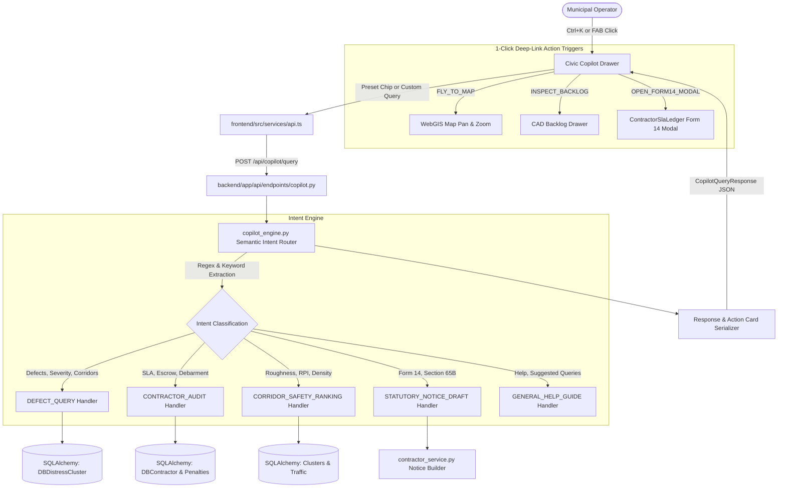

# Phase 15 Research: RoadSaathi Civic Copilot & Natural Language Intelligence

## Executive Summary

Phase 15 equips municipal commanders, traffic enforcement officers, and PWD engineers with a high-performance, natural language conversational assistant to query fleet telemetry, audit contractor SLA breaches, inspect road hazard hotspots, and automate statutory show-cause notice drafting. 

Following the user decisions in `15-DISCUSSION-LOG.md` (Area 1: Option 1 Deterministic Semantic Query Dispatcher; Area 2: Option 1 Floating Expandable Drawer + Ctrl/Cmd+K; Area 3: Option 1 Actionable Civic Cards with 1-Click Deep Links; Area 4: Option 1 Direct Pre-fill & Launch Section 65B Modal), the system runs 100% locally and deterministically on the FastAPI backend without requiring external cloud LLM dependencies or API keys. Response latency is sub-10ms, querying directly against SQLite WAL and PostgreSQL 16 schemas.

---

## 1. Architecture Overview



---

## 2. Backend Semantic Query Engine Dispatcher

### 2.1 Component Structure
- **Service Layer**: `backend/app/services/copilot_engine.py`
- **API Endpoint**: `backend/app/api/endpoints/copilot.py`
- **Route Mounting**: `backend/app/api/router.py` (mounted at `/copilot`)

### 2.2 Intent & Entity Extraction Architecture
The dispatcher processes natural language query strings using a deterministic pipeline:
1. **Text Normalization**: Lowercase conversion, punctuation stripping, whitespace normalization.
2. **Corridor Entity Resolution**:
   - Matches known corridors:
     - `GST Road` / `NH-32` / `Grand Southern Trunk`
     - `OMR` / `Old Mahabalipuram Road` / `IT Expressway`
     - `Anna Salai` / `Mount Road`
     - `Inner Ring Road` / `100 Feet Road` / `Jawaharlal Nehru Salai`
     - `Kathipara` / `Guindy`
     - `Mount-Poonamallee High Road`
     - `Velachery Main Road`
3. **Contractor Entity Resolution**:
   - Matches registered contractors:
     - `L&T` / `L&T Highways Infra Ltd` (CTR-01)
     - `GMR` / `GMR Urban Highways Ltd` (CTR-02)
     - `TNRDC` / `Tamil Nadu Road Dev Corp` (CTR-03)
     - `HCC` / `Hindustan Construction Co` (CTR-04)
     - `Chettinad` / `Chettinad Road Buildtech JV` (CTR-05)
4. **Severity Level Resolution**:
   - `P0` / `Critical` / `Emergency` (RPI > 85, high vertical shock > 1.35g)
   - `P1` / `High` / `Major` (alligator crack, deep depression)
   - `P2` / `Medium` / `Minor` (ravelling, minor wear)
5. **Defect Category Resolution**:
   - `pothole` / `D40`
   - `crack` / `alligator crack` / `D00` / `D10` / `D20`
   - `manhole` / `open manhole`
   - `waterlogging` / `flood` / `submerged`
   - `darkspot` / `illumination`
6. **Intent Router**:
   - `STATUTORY_NOTICE_DRAFT`: Matches patterns like `draft.*notice`, `form 14`, `section 65b`, `show cause`, `liquidated damages notice`.
   - `CONTRACTOR_AUDIT`: Matches patterns like `contractor`, `sla breach`, `escrow`, `debarment`, `penalt(y|ies)`, `performance of (l&t|gmr|hcc|chettinad|tnrdc)`.
   - `CORRIDOR_SAFETY_RANKING`: Matches patterns like `worst.*(road|corridor)`, `rank.*corridor`, `defect density`, `roughness.*rank`, `most potholes`.
   - `DEFECT_QUERY`: Matches patterns like `pothole`, `crack`, `p0`, `p1`, `unaddressed`, `active defect`, `open defect`, `show.*on (gst|omr|anna)`.
   - `GENERAL_HELP_GUIDE`: Fallback or explicit trigger matching `help`, `what can you do`, `how to use`, `suggestions`.

### 2.3 Data Models & Schemas

```python
# backend/app/schemas/copilot.py
from enum import Enum
from typing import Any, Dict, List, Optional, Union
from pydantic import BaseModel, Field

class CopilotActionType(str, Enum):
    FLY_TO_MAP = "FLY_TO_MAP"
    INSPECT_BACKLOG = "INSPECT_BACKLOG"
    VIEW_LEDGER = "VIEW_LEDGER"
    OPEN_FORM14_MODAL = "OPEN_FORM14_MODAL"
    FILTER_VIEW = "FILTER_VIEW"

class CopilotActionCard(BaseModel):
    id: str
    type: str # DEFECT_CLUSTER, CONTRACTOR_DOSSIER, CORRIDOR_METRIC, STATUTORY_NOTICE_CARD, HELP_GUIDE
    title: str
    subtitle: Optional[str] = None
    badge: Optional[str] = None
    badge_variant: Optional[str] = "indigo" # rose, amber, emerald, indigo, slate
    metrics: Dict[str, Union[str, int, float]] = Field(default_factory=dict)
    description: Optional[str] = None
    primary_action_label: Optional[str] = None
    primary_action_type: Optional[CopilotActionType] = None
    primary_action_payload: Optional[Dict[str, Any]] = None
    secondary_action_label: Optional[str] = None
    secondary_action_type: Optional[CopilotActionType] = None
    secondary_action_payload: Optional[Dict[str, Any]] = None

class CopilotQueryRequest(BaseModel):
    query: str
    context: Optional[Dict[str, Any]] = None

class CopilotQueryResponse(BaseModel):
    query: str
    intent: str
    executive_summary: str
    cards: List[CopilotActionCard] = Field(default_factory=list)
    suggested_queries: List[str] = Field(default_factory=list)
    latency_ms: float = 0.0
    statutory_context: Optional[str] = None
```

### 2.4 Intent Execution Logic

#### Intent 1: `DEFECT_QUERY`
- Queries `DBDistressCluster` matching corridor (using SQL `LIKE` / `ilike`), severity (mapping P0 -> critical, P1 -> high, P2 -> medium), and active status.
- Generates `DEFECT_CLUSTER` cards containing cluster code, road name, RPI roughness, detected camera, multi-pass concurrence count.
- Embeds primary action `FLY_TO_MAP` with `{lat, lng, zoom: 16, corridor_name}` and secondary action `INSPECT_BACKLOG` with `{cluster_code}`.

#### Intent 2: `CONTRACTOR_AUDIT`
- Queries `DBContractor` and `DBContractorPenalty`.
- If specific contractor requested, retrieves dossier including CIN, active vs breached work orders, on-time SLA %, compaction density, escrow deposit balance (`security_deposit_inr - penalties_deducted_inr`), and debarment warning status.
- If comparative audit requested ("contractors with highest breaches"), sorts by `breached_work_orders.desc()`.
- Embeds primary action `VIEW_LEDGER` with `{contractor_id}` and secondary action `DRAFT_FORM14` with `{contractor_id, contractor_name, assigned_corridor}`.

#### Intent 3: `CORRIDOR_SAFETY_RANKING`
- Groups `DBDistressCluster` by `road_name` to compute total defect counts, P0 emergency counts, and average RPI score.
- Sorts corridors by defect severity score descending.
- Generates `CORRIDOR_METRIC` cards with corridor center coordinates for 1-click map flying.

#### Intent 4: `STATUTORY_NOTICE_DRAFT`
- Dispatches statutory logic referencing `contractor_service.py`:
  - Recurrence count evaluation (1st = ₹25,000, 2nd = ₹50,000, 3rd+ = ₹1,00,000 + GeM debarment warning).
  - Generates official notice docket number format: `GCC/HW/FORM-14/{YEAR}/{DOCKET_SUFFIX}`.
  - Generates Section 65B BSA 2023 evidentiary certificate ID: `CERT-BSA2023-{YEAR}-{ID}`.
  - Computes SHA-256 digital evidence hash and statutory 7-day cure window deadline.
- Emits `STATUTORY_NOTICE_CARD` with primary action `OPEN_FORM14_MODAL` packing the complete notice payload for instant pre-fill in the UI.

#### Intent 5: `GENERAL_HELP_GUIDE`
- Returns concise municipal command tips, statutory references (IRC:SP:20 Cl 14.2, BSA 2023 Sec 65B), and quick suggestions.

---

## 3. Frontend Floating Drawer & Global Shortcut

### 3.1 Component Architecture
- File: `frontend/src/components/copilot/CivicCopilotDrawer.tsx`
- Integration Locations:
  - Accessible globally across `CommandCenter.tsx` and `WorkOrders.tsx` (or globally in `App.tsx` passing active route and navigation context).
  - Floating trigger button (FAB) anchored at `fixed bottom-6 right-6 z-40`.
  - High-contrast visual styling with gradient badge, glowing bot icon (`Sparkles`), and shortcut hint badge `Ctrl+K`.

### 3.2 Keyboard Navigation & Shortcuts
- `Ctrl + K` (Windows/Linux) and `Cmd + K` (macOS):
  - Toggles the Civic Copilot drawer open/closed.
  - Automatically focuses the query input field when opened.
  - Avoids collision with existing CommandPalette by remapping CommandPalette to `Ctrl + Shift + K` / `Ctrl + P`, or making `Ctrl + K` summon the intelligent Copilot directly.
- `Escape`:
  - Closes the drawer and restores focus to previous viewport element.

### 3.3 Quick-Prompt Suggestion Chips
- The drawer header and input area display interactive one-click suggestion chips:
  - `Show unaddressed P0 potholes on GST Road`
  - `Contractors with highest SLA breaches`
  - `Corridors with worst road condition`
  - `Draft Form 14 notice for L&T breaches`
- Clicking any chip immediately triggers query execution without typing.

### 3.4 Interactive Action Cards
Each action card renders structured municipal metadata:
- **Badge**: Color-coded severity or debarment indicator (`Critical`, `P0 Emergency`, `Warning`, `Passing`).
- **Tabular Metrics**: Monospace numerals displaying RPI score, breach count, escrow balance, penalty amount.
- **Action Buttons**:
  - `Fly to on Map`: Calls `onFlyToCorridor({ lat, lng, zoom, corridor })` which triggers MapLibre camera flyTo and selects the cluster.
  - `Inspect in Backlog`: Deep links to the CAD backlog table, filters by ticket ID, or opens the inspection console.
  - `Draft Form 14 Notice`: Emits notice payload to open the Section 65B Form 14 modal.

---

## 4. Form 14 Evidentiary Modal Integration

### 4.1 Evidentiary Show-Cause Modal Mechanics
In `frontend/src/components/workorders/ContractorSlaLedger.tsx`, the Form 14 notice modal (`activeModal === 'auto_debit_voucher'`) requires:
1. `selectedDebitRecord`: `AutoDebitRecord` / `Form14NoticeRecord`
2. `selectedContractor`: `ContractorAgency`
3. Digital signature flow for the Executive Engineer (EE) before statutory enforcement.

### 4.2 Deep-Link Pre-fill Flow
When the Copilot card emits `OPEN_FORM14_MODAL`:
1. Copilot receives payload containing:
   ```json
   {
     "id": "SCN-2026-COPILOT-01",
     "contractorId": "CTR-01",
     "contractorName": "L&T Highways Infra Ltd",
     "corridor": "GST Road Arterial (Airport to Tambaram, NH-32)",
     "clusterCode": "WO-2026-CHE-101",
     "patrolBusId": "BUS-TN01-1042",
     "measuredGz": 1.48,
     "thresholdGz": 1.30,
     "penaltyDebitInr": 25000,
     "remainingDepositInr": 4955000,
     "pfmsTxnRef": "PFMS/DLP-DEBIT/2026/1009-9021",
     "clause": "IRC:SP:20 Clause 14.2 & BSA 2023 Sec 63/65B",
     "status": "UNDER_NOTICE_CURE_PERIOD",
     "evidenceSha256": "4b227777d4dd1fc61c6f884f48641d02b4d121d3fd328cb08b5531fcacdabf8a",
     "noticeDocketNo": "GCC/HW/FORM-14/2026/1009-001",
     "cureDeadline": "2026-10-16 14:00 IST",
     "dlpTierMonths": 36,
     "section65bCertId": "CERT-BSA2023-2026-001"
   }
   ```
2. If the user is currently on the Command Center, Copilot navigates to `# /work-orders?tab=sla`.
3. An application-level event (`roadsaathi:open-form14`) or props handler triggers `ContractorSlaLedger.tsx` to set `selectedDebitRecord`, locate the matching `selectedContractor`, and set `activeModal = 'auto_debit_voucher'`.
4. The operator sees the pre-filled Form 14 notice pack immediately on screen with full evidence hash, ready for Executive Engineer review and digital signing.

---

## 5. API Client Integration (`frontend/src/services/api.ts`)

Add the client method to `api.ts`:
```typescript
async queryCopilot(request: CopilotQueryRequest): Promise<CopilotQueryResponse> {
  const res = await fetch(`${API_BASE}/copilot/query`, {
    method: 'POST',
    headers: this.getAuthHeaders(),
    body: JSON.stringify(request),
    signal: AbortSignal.timeout(5000),
  });
  if (!res.ok) {
    throw new Error(`Copilot query failed: ${res.statusText}`);
  }
  return res.json();
}
```

---

## 6. Validation Architecture

### 6.1 Automated Backend Test Suite
The backend test suite verifies:
1. Intent classification across all 5 municipal intents.
2. Correct entity extraction (corridors, severity, contractors).
3. Pydantic schema validation for request and response structures.
4. Database query filters against SQLite WAL and PostgreSQL.
5. Form 14 Section 65B payload integrity (SHA-256 hash format, 7-day cure window, Clause 14 penalty amount tiers).
6. Non-regression of existing contractor ledger, concurrence gating, and telematics physics tests.

**Test Command**:
```powershell
pytest -o pythonpath=backend backend/tests/test_copilot_engine.py backend/tests/test_contractor_ledger.py backend/tests/test_concurrence_gating.py backend/tests/test_telematics_physics.py -q
```

### 6.2 Frontend Type Checking and Build Verification
Ensures zero TypeScript errors and clean compilation of the new `CivicCopilotDrawer` component, FAB trigger, action cards, and deep-link hooks.

**Build Command**:
```powershell
npm --prefix frontend run build
```

---

## 7. Implementation Plan Breakdown

| Step | Scope | Target Files |
|---|---|---|
| 1 | Backend Service & Endpoint | `backend/app/services/copilot_engine.py`, `backend/app/api/endpoints/copilot.py`, `backend/app/api/router.py` |
| 2 | Backend Unit Tests | `backend/tests/test_copilot_engine.py` |
| 3 | Frontend API Client & Types | `frontend/src/types/index.ts`, `frontend/src/services/api.ts` |
| 4 | Frontend Civic Copilot Drawer Component | `frontend/src/components/copilot/CivicCopilotDrawer.tsx` |
| 5 | Command Center & Work Orders Deep-Linking Integration | `frontend/src/App.tsx`, `frontend/src/pages/CommandCenter.tsx`, `frontend/src/pages/WorkOrders.tsx`, `frontend/src/components/workorders/ContractorSlaLedger.tsx` |
| 6 | Verification & Validation | Automated pytest suite and Vite production build |
