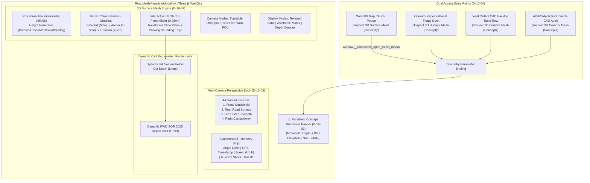
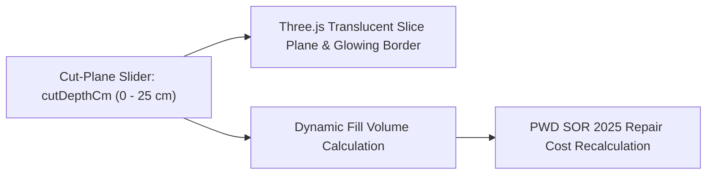

# Phase 16 Research: 3D Corridor Digital Twin & Surface Mesh Visualizer (Concept Prototype)

## Executive Summary

Phase 16 equips municipal commanders, PWD executive engineers, and highway maintenance auditors with an interactive 3D road surface elevation & cavity depth mesh explorer to inspect pavement distress topology, simulate cross-sectional depth slicing, and inspect multi-camera exterior perspectives from transit fleet buses.

In strict compliance with **Mandatory Constraint D-16-01**, all 3D surface elevation mesh views and corridor reconstructions are explicitly designated and framed as an **Experimental Concept / Proof of Concept Prototype** across all UI headers, inspection modal banners, button badges, tooltips, and documentation. The 3D surface geometry is synthesized computationally from monocular dashcam depth inference and IMU speed-normalized vertical shock profiles ($G_{norm} = \frac{\Delta G_z}{v / 30}$), not millimeter-grade mobile LiDAR survey hardware.

The implementation preserves RoadSaathi's lightweight, ponytail architectural philosophy: it extends the existing Three.js procedural WebGL canvas in [`RoadMeshVisualizerModal.tsx`](file:///c:/Users/sauja/Downloads/roads/frontend/src/components/modals/RoadMeshVisualizerModal.tsx), introduces interactive cut-plane depth slicing (0–25 cm) with dynamic cavity fill volume and repair cost recalculation, high-contrast elevation contour heatmaps, orbital turntable and driver walk POV camera modes, a 4-channel exterior perspective switcher (Front Windshield, Rear Road, Left Curb, Right Carriageway) with synchronized telemetry strips, and dual entry points across WebGIS Map inspection popups and the Work Orders CAD action console.

---

## 1. Architecture Overview



---

## 2. Concept Disclaimer Banner & Visual Warning Badge (D-16-01)

### 2.1 Problem Analysis
In municipal asset litigation and contractor SLA penalties under IRC:SP:20 Clause 14, legal disputes often arise if technical evidence is mischaracterized. Millimeter survey LiDAR vehicles cost ₹80L–₹2Cr per unit, whereas RoadSaathi leverages low-cost monocular transit dashcams + IMU sensor fusion. To ensure statutory and legal unassailability, the 3D surface elevation mesh must **never** be misrepresented as physical LiDAR survey scans.

### 2.2 Disclaimer Banner Specification
A persistent, non-dismissible amber/indigo banner is rendered across the entire width of the modal immediately below the title bar:

```tsx
{/* Persistent Concept Disclaimer Banner (D-16-01) */}
<div className="bg-amber-950/40 border-b border-amber-500/30 px-5 py-2.5 flex items-center justify-between text-xs text-amber-200">
  <div className="flex items-center gap-2.5">
    <AlertTriangle className="w-4 h-4 text-amber-400 shrink-0" />
    <span className="font-medium tracking-wide">
      <strong>⚠️ Experimental Concept / Proof-of-Concept Prototype:</strong> Pavement 3D surface mesh synthesized from monocular dashcam depth + IMU elevation profile (Non-LiDAR exploratory prototype).
    </span>
  </div>
  <div className="relative group">
    <button 
      type="button"
      className="p-1 rounded hover:bg-amber-900/50 text-amber-300 hover:text-amber-100 transition flex items-center gap-1 font-mono text-[10px] cursor-help"
      aria-label="Sensor Fusion Derivation Details"
    >
      <Info className="w-3.5 h-3.5" />
      <span>Derivation Info</span>
    </button>
    <div className="absolute right-0 top-full mt-1.5 w-80 p-3 rounded-xl bg-slate-900/95 border border-amber-500/40 text-[10.5px] text-slate-300 shadow-2xl backdrop-blur-md hidden group-hover:block z-50 pointer-events-none font-sans leading-relaxed">
      <div className="font-bold text-amber-300 mb-1 flex items-center gap-1 font-mono">
        <Sparkles className="w-3 h-3 text-amber-400" /> Sensor Fusion Derivation
      </div>
      Pavement 3D elevation topology is generated via optical disparity inference from monocular dashcam frames cross-correlated with speed-normalized vertical axle acceleration (<code className="text-amber-300 font-mono">G_norm = ΔG_z / (v/30)</code>). It provides interactive civil engineering estimation for rapid triage, rather than sub-millimeter terrestrial LiDAR surveying.
    </div>
  </div>
</div>
```

### 2.3 Universal Concept Pill Badges
- **Modal Header**: `Concept Prototype` pill badge rendered in amber/indigo next to hazard code.
- **WebGIS Map Cluster Popup**: `Inspect 3D Surface Mesh (Concept)` with amber `(Concept)` label.
- **Operator Inspector Panel**: `Inspect 3D Surface Mesh (Concept)` button.
- **Work Orders Backlog Table**: Table row action button styled with `(Concept)` badge and tooltip.
- **Work Order Action Console**: Drawer CAD Audit tab and action bar featuring `Inspect 3D Corridor Mesh (Concept)`.

---

## 3. 3D Surface Mesh & Depth Slicing Modes (D-16-02)

### 3.1 Procedural Surface Topology & Geometry
The 3D viewport utilizes Three.js `PlaneGeometry(10, 10, 96, 96)` rotated onto the XZ plane. Vertices are procedurally displaced along the Y-axis according to the active defect class:
- **Pothole Crater (D40)**: Organic asymmetric boundary using harmonic radial perturbation ($r(\theta) = r_0 (1 + 0.18 \sin 3\theta + 0.12 \cos 5\theta)$), steep sheared perimeter walls, and gravel/sub-base bottom roughness.
- **Alligator / Fatigue Crack (D10/D20)**: Main fracture line with lateral branching cracks and high-frequency fatigue webbing.
- **Sunken Manhole**: Rigid circular cast iron cover rim drop with surrounding asphalt sagging.
- **Waterlogged Basin**: Smooth concave depression filled with an interactive translucent planar water surface.

### 3.2 Interactive Depth Slicing Slider
Engineers can slice horizontally through the road cavity using a range slider ($0\text{ cm}$ to $25\text{ cm}$ with $0.5\text{ cm}$ step size):



#### Volumetric Cavity Formula
For an asymmetrical road cavity of maximum depth $d_{max}$ and surface volume $V_0$:
$$V(d_{cut}) = V_0 \times \left( \max\left(0, \frac{d_{max} - d_{cut}}{d_{max}}\right) \right)^{1.5}$$
- When $d_{cut} = 0\text{ cm}$ (surface baseline), $V = V_0$ (full cavity void).
- When $d_{cut} = d_{max}$, $V = 0\text{ Liters}$ (cut-plane reaches cavity floor).
- Hot-mix asphalt mass: $M_{asphalt} = V(d_{cut}) \times 2.3\text{ kg/L}$ (VG-30 Dense Bituminous Macadam standard density).
- PWD SOR Repair Cost: $\text{Cost}(d_{cut}) = \text{costInr} \times \frac{V(d_{cut})}{V_0}$, dynamically displayed in real-time.

#### Cut-Plane 3D Visualization in Three.js
A horizontal translucent plane (`THREE.Mesh` with `THREE.PlaneGeometry(10, 10)`) is positioned at:
$$y_{cut} = - \left( \frac{d_{cut}}{d_{max}} \right) \times |y_{deepest}|$$
- Material: `THREE.MeshStandardMaterial({ color: 0x06b6d4, transparent: true, opacity: 0.35, side: THREE.DoubleSide })`
- Edge wireframe: `THREE.LineSegments` surrounding the cut perimeter with cyan/amber glowing line material.

### 3.3 Elevation Contour Heatmaps (Vertex Color Gradient)
Vertices are colored according to high-contrast engineering thresholds:
1. **Emerald Green** (`#10B981` / RGB 0.06, 0.73, 0.51): Surface baseline ($0\text{ cm}$ down to $-1\text{ cm}$).
2. **Goldenrod Amber** (`#F59E0B` / RGB 0.96, 0.62, 0.04): Rutting / shear transition ($-1\text{ cm}$ to $-5\text{ cm}$).
3. **Crimson Red** (`#E11D48` / RGB 0.88, 0.11, 0.28): Critical structural cavity void ($> 5\text{ cm}$).

### 3.4 Display Modes & Camera Inspection Controls
- **Display Modes**:
  - `Textured Solid`: Realistic asphalt roughness with aggregate grain and specular response.
  - `Wireframe Matrix`: Glowing cyan/emerald wireframe matrix showing vertex elevation mesh density.
  - `Depth Contour`: Full false-color elevation gradient map across vertices.
- **Inspection Camera Modes**:
  - `Turntable Orbit View`: Perspective camera at $(0, 9.5, 12)$ looking at $(0, -0.8, 0)$ with 360° mouse drag rotation and wheel zoom.
  - `Driver / Walk POV View`: Low-angle viewpoint at $(0, 1.8, 6.2)$ looking down-forward at $(0, -0.4, 0)$, simulating an approaching driver's windshield line-of-sight or walking inspection engineer.

---

## 4. Multi-Camera Perspective Switcher (D-16-03)

### 4.1 4-Channel Exterior Perspective Dock
Transit fleet buses feature multi-angle surveillance rigs to capture 360° road corridor dynamics. The switcher dock provides 4 exterior camera feeds:

| Channel | Camera Perspective | Inspection Purpose | Sensor Telemetry |
|---|---|---|---|
| **CAM-01** | **Front Windshield Dashcam** | Primary optical hazard detection, approach trajectory, forward bounding box | $v = 38.4\text{ km/h}$, $G_{norm} = 2.19\text{g}$, Conf: 94% |
| **CAM-02** | **Rear Road Surface Overview** | Trailing rear axle impact verification, post-strike depression, vehicle wake | $v = 36.2\text{ km/h}$, $G_{norm} = 2.80\text{g}$ (Peak Axle), Conf: 96% |
| **CAM-03** | **Left Curb / Footpath View** | Sidewalk clearance, curb subsidence, roadside drainage inlets, open utility manholes | $v = 38.4\text{ km/h}$, $G_{norm} = 0.42\text{g}$, Lateral Offset: 1.8m |
| **CAM-04** | **Right Carriageway / Overtaking** | Median divider integrity, lane encroachment, overtaking vehicle clearance, traffic flow | $v = 38.4\text{ km/h}$, $G_{norm} = 0.38\text{g}$, Lane: Fast Lane |

### 4.2 Synchronized Telemetry Strip
Every exterior perspective renders a standardized, real-time HUD telemetry strip:
- Channel code & label: e.g. `CAM-01 • FRONT WINDSHIELD DASHCAM`
- GPS ISO Timestamp: e.g. `Today, 07:14:22.420 IST`
- Vehicle Speed: $v_{km/h}$ (e.g. `38.4 KM/H`)
- Speed-Normalized Vertical Shock: $G_{norm} = \frac{\Delta G_z}{v / 30}$ (e.g. `+2.19g Z-AXLE`)
- Monitored Bus Identifier: e.g. `Bus #04 (TN-01-N-1042)`
- Spatial Coordinates: e.g. `12.9516°N, 80.1462°E`

---

## 5. Dual Access Triggers & Parameter Binding (D-16-04)

### 5.1 WebGIS Map Integration
1. **Cluster Popup Card in `WebGISMap.tsx`**:
   The HTML popup generated for defect markers includes a dedicated CTA button alongside the RPI formula inspection button:
   ```html
   <button 
     onclick="window.__roadsaathi_open_mesh_modal?.('${cluster.id}')"
     style="width: 100%; margin-top: 4px; padding: 5px 6px; background: #0f172a; color: #f59e0b; font-size: 10px; font-weight: 700; border-radius: 5px; border: 1px solid rgba(245,158,11,0.4); cursor: pointer; display: flex; align-items: center; justify-content: center; gap: 4px;"
   >
     <span>⚠️ Inspect 3D Surface Mesh (Concept) &rarr;</span>
   </button>
   ```
2. **Command Center Global Binding**:
   In `CommandCenter.tsx`, `window.__roadsaathi_open_mesh_modal` is bound to retrieve the selected cluster and trigger `RoadMeshVisualizerModal.tsx`:
   ```typescript
   useEffect(() => {
     (window as any).__roadsaathi_open_mesh_modal = (clusterId: string) => {
       const cluster = clusters.find(c => c.id === clusterId);
       if (cluster) {
         handleInspectPothole(cluster.id, `${cluster.road_name} — ${cluster.defect_name}`);
       }
     };
     return () => {
       delete (window as any).__roadsaathi_open_mesh_modal;
     };
   }, [clusters]);
   ```
3. **Operator Inspector Panel Integration**:
   In `OperatorInspectorPanel.tsx`, road surface defect clusters render an explicit `Inspect 3D Surface Mesh (Concept)` action trigger.

### 5.2 Work Orders Integration
1. **CAD Backlog Table Row in `WorkOrders.tsx`**:
   The action column displays an explicit `Inspect 3D Corridor Mesh (Concept)` trigger for road surface defects (`isRoadSurfaceDefect(cluster.defect_name)`), styled with an amber `(Concept)` badge pill and tooltip.
2. **CAD Audit Tab in `WorkOrderActionConsole.tsx`**:
   Inside the Volumetric Material calculation card, an action button is rendered:
   ```tsx
   <button
     type="button"
     onClick={() => onInspect3DMesh?.(cluster)}
     className="w-full mt-3 py-2 px-3 rounded-lg bg-amber-500/10 hover:bg-amber-500/20 text-amber-300 border border-amber-500/30 text-xs font-semibold flex items-center justify-center gap-2 transition"
   >
     <Box className="w-3.5 h-3.5 text-amber-400" />
     <span>Inspect 3D Corridor Mesh (Concept)</span>
   </button>
   ```
3. **Seamless State Propagation**:
   In `WorkOrders.tsx`, `onInspect3DMesh` sets `inspectingMeshCluster(cluster)`, immediately rendering `RoadMeshVisualizerModal.tsx` pre-bound to the defect's exact telemetry, depth, volume, and multi-camera perspectives.

---

## 6. Validation Architecture

### 6.1 Backend Automated Regression Suite
Execute the full backend test suite to guarantee 100% test pass rate across Copilot, contractor ledger, concurrence gating, and telematics physics:
```powershell
pytest -o pythonpath=backend backend/tests/test_copilot_engine.py backend/tests/test_contractor_ledger.py backend/tests/test_concurrence_gating.py backend/tests/test_telematics_physics.py -q
```
**Target Invariant**: All 54 tests pass with 0 errors.

### 6.2 Frontend Compilation & Type Safety
Execute the Vite production build to guarantee zero TypeScript diagnostics, clean module tree compilation, and asset bundling:
```powershell
npm --prefix frontend run build
```
**Target Invariant**: `tsc && vite build` succeeds with 0 errors and zero unhandled type regressions.

### 6.3 Performance & WebGL Resource Management
1. **60 FPS Rendering Target**: Procedure geometry bounded to 96x96 segments ($9,216$ vertices) to guarantee steady 60 FPS on integrated and mobile GPUs.
2. **Zero Memory Leaks on Modal Close**: The unmount hook must systematically traverse and dispose all geometries (`geometry.dispose()`), materials (`material.dispose()`), textures, and call `renderer.forceContextLoss()` and `renderer.dispose()` with cancellation of `requestAnimationFrame`.

---

## 7. Implementation Roadmap & Plan

1. **Step 1: Enhance `RoadMeshVisualizerModal.tsx`**:
   - Add persistent amber/indigo concept disclaimer banner with sensor fusion derivation tooltip (D-16-01).
   - Add interactive cut-plane depth slider ($0$ to $25\text{ cm}$) with dynamic fill volume and repair cost recalculation (D-16-02).
   - Add 3-way mesh display toggle (Textured Solid, Wireframe Matrix, Depth Contour Heatmap) and Three.js vertex color elevation gradient (Emerald $\rightarrow$ Amber $\rightarrow$ Crimson) (D-16-02).
   - Add turntable orbit vs driver walk POV camera switcher (D-16-02).
   - Add 4-channel exterior perspective switcher dock (Front, Rear, Left Curb, Right Carriageway) with synchronized telemetry strip (D-16-03).
2. **Step 2: Add WebGIS Map Trigger (`WebGISMap.tsx` & `CommandCenter.tsx`)**:
   - Add "Inspect 3D Surface Mesh (Concept)" CTA button in cluster map popups.
   - Bind `window.__roadsaathi_open_mesh_modal` in `CommandCenter.tsx`.
   - Wire `onOpenMeshModal` in `OperatorInspectorPanel.tsx`.
3. **Step 3: Add Work Orders Triggers (`WorkOrderActionConsole.tsx` & `WorkOrders.tsx`)**:
   - Add `onInspect3DMesh` prop to `WorkOrderActionConsole.tsx` and render action button in CAD Audit tab.
   - Wire `onInspect3DMesh` in `WorkOrders.tsx` to launch `RoadMeshVisualizerModal.tsx`.
   - Polish CAD Backlog table action with explicit `(Concept)` badging.
4. **Step 4: Verification & Automated Test Run**:
   - Run backend test suite (54 tests).
   - Run frontend build (`npm --prefix frontend run build`).

---
