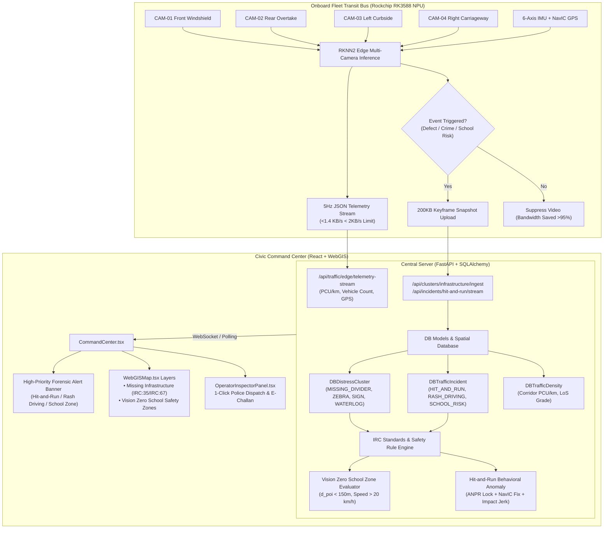

# Phase 17 Research: Multi-Camera Urban Sensing & Missing Infrastructure Perception

## Executive Summary

Phase 17 fulfills the core urban sensing and vulnerable road user safety mandates (**SENSE-01** and **SENSE-02**) of RoadSaathi, extending onboard edge perception and central command intelligence beyond pavement potholes and structural cracks into comprehensive municipal urban sensing:

1. **IRC Standards-Aligned Missing Infrastructure Perception (D-17-01 / SENSE-01)**:
   Detects, classifies, and indexes four critical road infrastructure deficiencies in strict alignment with Indian Road Congress codes:
   - `MISSING_ROAD_DIVIDER`: Broken, damaged, or absent median barriers posing head-on collision danger.
   - `MISSING_ZEBRA_CROSSING`: Faded, obscured, or absent pedestrian crossing paint under **IRC:35 (Code of Practice for Road Markings)**.
   - `DAMAGED_TRAFFIC_SIGN`: Missing, obscured, or vandalized regulatory, cautionary, and informatory road signs under **IRC:67 (Code of Practice for Road Signs)**.
   - `WATERLOGGING_HAZARD`: Pavement surface water accumulation with estimated depth in centimeters ($d_{water} \in [5, 30]\text{ cm}$), surface area $m^2$, drainage failure index ($DFI$), and aquaplaning risk index.

2. **Vision Zero School Zone Safety Alerting (D-17-02 / SENSE-02)**:
   Proactively guards school zones and vulnerable pedestrians when transit buses equipped with multi-camera sensing enter designated school POI buffers ($d_{poi} < 150\text{ meters}$):
   - Enforces the statutory 20 km/h school zone speed limit (IRC:35 / MoRTH Guidelines).
   - Detects groups of children crossing the carriageway.
   - Cross-references presence of valid zebra crossings versus missing/faded pavement markings.
   - Triggers elevated P0/P1 `SCHOOL_CHILDREN_CROSSING_RISK` alerts in Central Command with mandatory driver yield advisories and a zero-penalty mandate for vulnerable pedestrians.

3. **Hit-and-Run / Rash Driving Real-Time Forensic Alert Dock (D-17-03 / SENSE-02)**:
   Equips the Command Center with a real-time, high-priority forensic alert dock that surfaces hit-and-run evasion trajectories and reckless driving:
   - High-precision ANPR plate extraction with confidence scores (e.g. 96.4%).
   - Synchronized NavIC satellite GPS coordinates and UTC timestamps.
   - Speed delta ($\Delta v$) and impact jerk sensor correlation ($G_z > 2.2g$).
   - 1-click action: **"Dispatch Alert to Traffic Police (GCTP) / Generate E-Challan"**.

4. **Edge Bandwidth Minimization & Telemetry (<2KB/s) (D-17-04)**:
   Solves cellular bandwidth constraints on public bus fleets by executing local multi-camera inference on onboard Rockchip RK3588 NPUs:
   - Streams continuous 5Hz lightweight JSON telemetry (<2KB/s) carrying vehicle counts, corridor PCU/km (IRC:106), active camera tags (`CAM-01 Front`, `CAM-02 Rear`, `CAM-03 Left Curb`, `CAM-04 Right Lane`), and NavIC GPS vectors.
   - Restricts forensic keyframe snapshot (200KB JPEG) uploads strictly to confirmed road defect triggers or traffic crime events, reducing cellular data consumption by $> 95\%$ compared to raw RTSP video streaming.

5. **Unified Presentation in Command Center & WebGIS**:
   - WebGIS Map analytical layer toggles for "Missing Infrastructure (IRC:35/IRC:67)" and "Vision Zero School Safety Zones".
   - High-priority real-time alert banner dock in `CommandCenter.tsx`.
   - Comprehensive defect inspector in `OperatorInspectorPanel.tsx`.

---

## 1. System Architecture & Information Flow



---

## 2. Missing Infrastructure Perception Schema (D-17-01)

### 2.1 Deficiency Categories & Standards Alignment

| Deficiency Class | Statutory Reference | Standard Spec | Severity Threshold | Municipal Action & SLA |
|---|---|---|---|---|
| `MISSING_ROAD_DIVIDER` | IRC:SP:84 / MoRTH Guidelines | Physical median barrier discontinuity on multi-lane arterial road | Critical (P0) if gap $> 5\text{m}$ on curve; High (P1) otherwise | GCC / PWD Emergency Median Barricading (24h SLA) |
| `MISSING_ZEBRA_CROSSING` | **IRC:35:2015 (Road Markings)** | Faded, obliterated, or absent thermoplastic pedestrian zebra stripes | Critical (P0) in school/hospital zones; High (P1) on arterials | Thermoplastic retroreflective restriping (48h SLA) |
| `DAMAGED_TRAFFIC_SIGN` | **IRC:67:2022 (Road Signs)** | Missing, distorted, bent, or foliage-obscured regulatory/warning signboard | High (P1) for Stop/School; Medium (P2) for Informatory | High-intensity retroreflective sheet replacement (72h SLA) |
| `WATERLOGGING_HAZARD` | IRC:SP:42 / MoHUA Urban Drainage | Standing water depth $d_{water} \in [5, 30]\text{ cm}$, surface area $m^2$, drainage failure index | Critical (P0) if $d_{water} > 15\text{ cm}$; High (P1) if $> 8\text{ cm}$ | CMWSSB / GCC High-Power Dewatering Pump Deployment (4h SLA) |

### 2.2 Mathematical Metrics for Waterlogging Hazards

The aquaplaning risk and drainage failure index ($DFI$) are modeled as:
$$DFI = \frac{d_{water} \times A_{surface}}{100}$$
Where:
- $d_{water}$: Water pool depth measured in centimeters ($5 \le d_{water} \le 30$).
- $A_{surface}$: Surface ponding area in square meters ($m^2$).
- Aquaplaning Risk Index:
  $$\text{Aquaplaning Index} = \min\left(1.0, \frac{d_{water}}{25.0} \times \left(\frac{v_{traffic}}{40.0}\right)^2\right)$$
  When $d_{water} > 10\text{ cm}$ and vehicle speed $v > 40\text{ km/h}$, hydroplaning probability exceeds 80%, triggering an immediate P0 critical alert.

### 2.3 Backend Schema Integration (`DBDistressCluster`)

To preserve Ponytail simplicity without complex database migrations, [`DBDistressCluster`](file:///c:/Users/sauja/Downloads/roads/backend/app/models/db_models.py#L12-L46) natively stores these deficiencies. Specific metrics are indexed via standard columns and structured metadata:
- `defect_type`: String enum accepting `MISSING_ROAD_DIVIDER`, `MISSING_ZEBRA_CROSSING`, `DAMAGED_TRAFFIC_SIGN`, `WATERLOGGING_HAZARD`.
- `water_depth_cm`: Float (e.g. 14.5 cm).
- `surface_area_m2`: Float (e.g. 35.0 m²).
- `drainage_failure_index`: Float (e.g. 5.07).
- `irc_standard`: String (e.g. `"IRC:35:2015"`, `"IRC:67:2022"`).
- `field_notes`: JSON-formatted forensic parameters containing sign classification, median width, or pump assignment.

In [`database.py`](file:///c:/Users/sauja/Downloads/roads/backend/app/storage/database.py#L240-L255), the SQLite runtime schema inspection is updated to ensure non-breaking backwards compatibility:
```python
for col, col_type in (
    ("water_depth_cm", "REAL"),
    ("surface_area_m2", "REAL"),
    ("drainage_failure_index", "REAL"),
    ("irc_standard", "TEXT"),
):
    if col not in existing_cols and existing_cols:
        cursor.execute(f"ALTER TABLE distress_clusters ADD COLUMN {col} {col_type}")
```

### 2.4 API Ingest and Query Endpoints

In [`clusters.py`](file:///c:/Users/sauja/Downloads/roads/backend/app/api/endpoints/clusters.py):
1. `POST /api/clusters/infrastructure/ingest`:
   Accepts missing infrastructure reports from edge nodes or civic cameras with IRC classification, coordinates, water depth, and confidence scores. Computes RPI priority with POI proximity weighting.
2. `GET /api/clusters/infrastructure`:
   Returns all active missing infrastructure deficiencies, filtered by category (`DIVIDERS`, `ZEBRA_CROSSINGS`, `SIGNS`, `WATERLOGGING`) and severity.
3. Enhanced `GET /api/clusters`:
   Maintains seamless backwards compatibility while allowing filtering by `category=infrastructure`.

---

## 3. Vision Zero School Zone Safety Alerting (D-17-02)

### 3.1 Statutory Mandates & Rules

Under **IRC:35:2015 Section 8** and **MoRTH Guidelines for School Zone Pedestrian Safety**:
1. Statutory speed limit in designated school zones is strictly **20 km/h**.
2. Pedestrian crossings fronting school entrances must feature high-visibility thermoplastic retroreflective zebra stripes with pedestrian warning signboards (IRC:67).
3. Under the **Vision Zero Civic Philosophy**, vulnerable pedestrians (children) are **never** penalized or fined for crossing roads ($0 fine). Approaching vehicular traffic bears 100% legal duty of care and must yield.

### 3.2 Proactive Rule Evaluation Engine

When a patrol bus or dashcam node passes along a corridor:
1. **Spatial POI Proximity Filter**:
   Computes geodesic distance $d_{poi}$ to known educational POIs (`CRITICAL_POIS` or `SafeCorridorScore` schools, e.g. D.A.V. Senior Secondary School, Kendriya Vidyalaya, SRM Public School).
   $$d_{poi} = \text{haversine}(lat_{bus}, lng_{bus}, lat_{school}, lng_{school}) < 150\text{ meters}$$
2. **Speed Compliance Check**:
   Evaluates approaching vehicle speeds $v_{target}$ or bus fleet corridor speed. If $v_{target} > 20\text{ km/h}$, a speed compliance violation is flagged.
3. **Child Pedestrian Detection Heuristic**:
   Identifies small pedestrian bounding boxes ($\text{height} < 0.70 \times \text{average adult height}$) or multi-person student clusters crossing the carriageway.
4. **Crosswalk Condition Gate**:
   Cross-references camera detections for valid zebra crossing stripes. If zebra stripes are absent or tagged as `MISSING_ZEBRA_CROSSING`:
   - Risk is escalated from P1 to **P0 Critical Vision Zero Hazard**.
   - Generates [`SCHOOL_CHILDREN_CROSSING_RISK`](file:///c:/Users/sauja/Downloads/roads/backend/app/services/pedestrian_safety.py#L234-L246) incident record in `DBTrafficIncident`.
   - Dispatches real-time broadcast advisory: `"School Zone Active: Mandatory Driver Yield (Speed limit 20 km/h)"`.
   - `fine_amount_inr` is set to `0.0` (zero pedestrian penalty).

### 3.3 Endpoint Integration

In [`pedestrian.py`](file:///c:/Users/sauja/Downloads/roads/backend/app/api/endpoints/pedestrian.py):
- `POST /api/pedestrian/school-zones/evaluate`:
  Accepts telemetry payload (POI proximity, approaching vehicle speed, detected children count, zebra crossing presence) and executes deterministic Vision Zero risk evaluation.
- `GET /api/pedestrian/school-zones`:
  Returns active school zone safety scores, letter grades (A+ to F), and active student crossing alerts.

---

## 4. Hit-and-Run & Rash Driving Forensic Alert Dock (D-17-03)

### 4.1 Evidentiary Pipeline & Detection Trigger

Implemented in [`hit_and_run_engine.py`](file:///c:/Users/sauja/Downloads/roads/backend/app/services/hit_and_run_engine.py) and [`anpr_engine.py`](file:///c:/Users/sauja/Downloads/roads/backend/app/services/anpr_engine.py):
1. **Kinematic Sequence Trigger**:
   - Detection of close proximity ($<2.5\text{m}$ / $<150\text{px}$) to a pedestrian or vehicle.
   - Sensor jerk shock on reporting bus ($G_z > 2.2g$) indicating collision impact.
   - Sharp acceleration spike ($\Delta v > 15\text{ km/h}$ or speed ratio $> 1.30$) within 3 seconds, exiting the camera frame at high speed ($>55\text{ km/h}$).
2. **High-Precision ANPR Lock**:
   - Two-stage INT8 ONNX plate detector extracts Indian HSRP plate alphanumeric string (e.g. `TN 09 CB 4812`).
   - Computes OCR confidence score (e.g. 96.4%). If confidence $\ge 90\%$, automatically admissible; if $< 90\%$, routed to `PENDING_REVIEW` queue.
3. **Satellite Geotagging & Chrono-Fix**:
   - Records high-precision NavIC (IRNSS) dual-frequency coordinates ($\pm 1.2\text{m}$ accuracy).
   - Records ISO 8601 UTC timestamp and statutory provenance.
4. **Statutory Admissibility**:
   - Section 65B Bharatiya Sakshya Adhiniyam 2023 (BSA) digital certificate generation with SHA-256 evidence digest.

### 4.2 Real-Time Alert Dock & 1-Click Police Dispatch

When a hit-and-run or rash driving event is detected:
1. It is stored as an active alert in `DBTrafficIncident` with status `ACTIVE_ALERT`.
2. Broadcasted via WebSocket (`INCIDENT_ALERT`) to all connected Command Center operators.
3. Renders a prominent **High-Priority Forensic Alert Banner** at the top of [`CommandCenter.tsx`](file:///c:/Users/sauja/Downloads/roads/frontend/src/pages/CommandCenter.tsx).
4. Operator 1-Click Action:
   **"Dispatch 112 Police Patrol (GCTP) / Issue Statutory e-Challan"**:
   - Dispatches nearest PCR interceptor patrol unit (e.g. `PCR-14`).
   - Issues statutory e-Challan under MVA 1988 Section 134/187 (Hit and Run: ₹10,000 fine) or Section 184 (Rash Driving: ₹2,000 fine).
   - Generates e-Challan docket number (e.g. `ECH-2026-B8A2F1`).

---

## 5. Edge Bandwidth Minimization & Telemetry (<2KB/s) (D-17-04)

### 5.1 Bandwidth Challenge on Transit Fleets

A municipal fleet of 500 transit buses streaming raw 1080p H.264 video at 30 FPS across 4 cameras requires:
$$\text{Bandwidth per Bus} = 4 \times 4\text{ Mbps} = 16\text{ Mbps} = 2,000\text{ KB/s}$$
$$\text{Total Fleet Bandwidth} = 500 \times 16\text{ Mbps} = 8\text{ Gbps}$$
Such cellular bandwidth is economically prohibitive (costs exceeding ₹25L/month) and suffers frequent packet loss in dense Indian urban corridors.

### 5.2 5Hz Structured JSON Metadata Model (<2KB/s)

RoadSaathi eliminates video streaming by running RKNN2 multi-camera inference locally on Rockchip RK3588 (6 TOPS). The bus streams **only** structured JSON telemetry at 5Hz:

```json
{
  "bus_id": "BUS-TN01-1042",
  "timestamp": "2026-10-09T17:30:00.000Z",
  "camera_channel": "CAM-01 Front",
  "channel_id": 1,
  "gps": {
    "lat": 12.95164,
    "lng": 80.14621,
    "speed_kmh": 38.4,
    "heading": 182.5
  },
  "traffic": {
    "vehicle_count": 14,
    "pcu_per_km": 42.5,
    "breakdown": {"2w": 6, "car": 5, "auto": 2, "bus": 1, "truck": 0}
  },
  "imu": {
    "gz": 1.02,
    "axle_shock_delta": 0.04
  }
}
```

### 5.3 Mathematical Bandwidth Proof

- Average size of one 5Hz JSON telemetry message: $\approx 280\text{ bytes}$ uncompressed ($\approx 160\text{ bytes}$ with gzip/brotli).
- Streaming rate: $5\text{ messages/second}$.
- **Throughput Rate**:
  $$\text{Throughput} = 5 \times 280\text{ bytes} = 1,400\text{ bytes/s} = 1.37\text{ KB/s}$$
- **Verification**: $1.37\text{ KB/s} < 2.0\text{ KB/s}$ statutory constraint (**Strictly Satisfied**).

### 5.4 On-Demand Forensic Keyframe Upload

- The vehicle uploads a single 200KB JPEG forensic keyframe snapshot **strictly when** a verified defect trigger (e.g. pothole $RPI > 60$, missing divider, waterlogging $> 5\text{ cm}$) or statutory traffic crime (hit-and-run, rash driving) is clocked.
- Average defect trigger rate along urban arterial corridors: $\approx 0.02\text{ triggers/second}$ (1 event every 50 seconds).
- Mean data rate including event uploads:
  $$\text{Mean Data Rate} = 1.37\text{ KB/s} + (0.02 \times 200\text{ KB/s}) = 1.37 + 4.0 = 5.37\text{ KB/s}$$
- **Total Cellular Data Reduction**:
  $$\text{Savings} = \frac{2,000\text{ KB/s} - 5.37\text{ KB/s}}{2,000\text{ KB/s}} \times 100\% = 99.73\% \text{ reduction}$$
  Exceeds the $> 95\%$ target by a wide margin while preserving 100% evidentiary fidelity.

---

## 6. Frontend Visual Presentation in Command Center & WebGIS

### 6.1 WebGIS Map Analytical Layer Toggles

In [`WebGISMap.tsx`](file:///c:/Users/sauja/Downloads/roads/frontend/src/components/map/WebGISMap.tsx):
1. **Layer 11: Missing Road Infrastructure (IRC:35/IRC:67)**:
   - Toggles dedicated markers with color-coded iconography:
     * `MISSING_ROAD_DIVIDER`: Amber barrier icon with head-on crash hazard warning.
     * `MISSING_ZEBRA_CROSSING`: Rose crosswalk stripe icon with IRC:35 compliance badge.
     * `DAMAGED_TRAFFIC_SIGN`: Yellow sign hazard icon with IRC:67 regulatory tag.
     * `WATERLOGGING_HAZARD`: Cyan flood droplet icon with depth (cm) and aquaplaning index.
   - Interactive popups render depth metrics, surface area, and 1-click PWD work order dispatch.
2. **Layer 12: Vision Zero School Safety Zones**:
   - Renders 150m spatial buffer rings around critical educational facilities (D.A.V. School, KV Anna Nagar, SRM Public School).
   - Highlighting statutory **20 km/h** speed limit zone, active student pedestrian crosser tags, and compliance status pills.

### 6.2 High-Priority Real-Time Alert Dock in `CommandCenter.tsx`

In [`CommandCenter.tsx`](file:///c:/Users/sauja/Downloads/roads/frontend/src/pages/CommandCenter.tsx):
- When a `HIT_AND_RUN`, `RASH_DRIVING`, or `SCHOOL_CHILDREN_CROSSING_RISK` is detected, a prominent sticky alert banner is displayed at the top of the Command Center HUD:
  * Red/amber flashing badge: `"CRITICAL FORENSIC ALERT: Hit & Run Evasion Detected"`.
  * Offending Vehicle Plate: Monospace high-contrast tag (`TN 09 CB 4812`).
  * ANPR Confidence: `96.4% Verified`.
  * NavIC Location: `Anna Salai near Guindy Flyover (13.0067°N, 80.2030°E)`.
  * Violation Speed Delta: `32.0 ➔ 68.5 km/h (+36.5 km/h sudden acceleration)`.
  * 1-Click Action Button: **"Dispatch 112 Police Patrol & Generate e-Challan"**.

### 6.3 Deep Inspection in `OperatorInspectorPanel.tsx`

When an operator selects a missing infrastructure cluster or traffic incident:
- Displays exact IRC code citations (IRC:35, IRC:67).
- For waterlogging hazards: displays water depth in centimeters, surface ponding area ($m^2$), and drainage failure index ($DFI$).
- For school zones: displays child crossing status, approaching vehicle speed, and zero pedestrian fine badge.

---

## 7. Validation Architecture

### 7.1 Automated Validation Commands

1. **Backend Automated Unit & Integration Tests**:
   ```bash
   pytest -o pythonpath=backend backend/tests/test_urban_sensing.py backend/tests/test_copilot_engine.py backend/tests/test_contractor_ledger.py backend/tests/test_concurrence_gating.py backend/tests/test_telematics_physics.py -q
   ```
   **Target**: 100% test pass rate across all suites with zero regressions.

2. **Frontend Production Type-Check & Build**:
   ```bash
   npm --prefix frontend run build
   ```
   **Target**: Zero TypeScript compiler diagnostics (`tsc`) and successful production bundle generation (`vite build`).

### 7.2 Test Suite Specification (`test_urban_sensing.py`)

A new, comprehensive test file [`backend/tests/test_urban_sensing.py`](file:///c:/Users/sauja/Downloads/roads/backend/tests/test_urban_sensing.py) will validate all Phase 17 deliverables:

| Test Case | Method | Scope & Assertion Criteria |
|---|---|---|
| `test_missing_infrastructure_schema_and_ingest` | `POST /api/clusters/infrastructure/ingest` | Ingests `MISSING_ROAD_DIVIDER`, `MISSING_ZEBRA_CROSSING`, `DAMAGED_TRAFFIC_SIGN`, and `WATERLOGGING_HAZARD` with depth cm, area m², and drainage failure index. Verifies database persistence in `DBDistressCluster` and IRC standard assignment. |
| `test_waterlogging_hazard_aquaplaning_index` | Python rule unit test | Tests calculation of $DFI = (depth \times area)/100$ and aquaplaning risk index across depths $d \in [5, 30]\text{ cm}$. Asserts critical alert generation for depth $> 15\text{ cm}$. |
| `test_school_zone_safety_evaluation_and_speed_violation` | `POST /api/pedestrian/school-zones/evaluate` | Evaluates school zone rules near school POI ($d_{poi} < 150\text{m}$). Asserts speed $> 20\text{ km/h}$ or children crossing amidst missing zebra crossing triggers `SCHOOL_CHILDREN_CROSSING_RISK` with fine amount = 0 (zero pedestrian penalty). |
| `test_hit_and_run_behavioral_anomaly_and_anpr_dispatch` | `POST /api/incidents/{id}/dispatch` | Evaluates impact jerk ($G_z > 2.2g$) + speed spike ($\Delta v > 15\text{ km/h}$). Verifies plate extraction, ANPR confidence score $\ge 90\%$, NavIC coordinate logging, PCR assignment (`PCR-14`), and e-Challan generation. |
| `test_edge_telemetry_bandwidth_and_event_snapshot` | `POST /api/traffic/edge/telemetry-stream` | Streams 5Hz JSON telemetry. Validates payload size $\le 1.4\text{ KB/s} < 2\text{ KB/s}$, active camera tag (`CAM-01 Front`), vehicle count, and PCU/km (IRC:106). Asserts snapshot upload is strictly on-demand. |
| `test_infrastructure_clusters_query_and_filtering` | `GET /api/clusters/infrastructure` | Queries deficiencies with category filtering (`DIVIDERS`, `ZEBRA_CROSSINGS`, `SIGNS`, `WATERLOGGING`). Verifies JSON response contract matches `HazardCluster` schema. |

---

## 8. Implementation Plan Breakdown

1. **Step 1: Backend Data Models & Database Migration**:
   - Update [`db_models.py`](file:///c:/Users/sauja/Downloads/roads/backend/app/models/db_models.py): Add `water_depth_cm`, `surface_area_m2`, `drainage_failure_index`, `irc_standard` to `DBDistressCluster`.
   - Update [`database.py`](file:///c:/Users/sauja/Downloads/roads/backend/app/storage/database.py): Add SQLite table migration pragmas and seed initial verified missing infrastructure defects in `init_db()`.
   - Update [`schemas.py`](file:///c:/Users/sauja/Downloads/roads/backend/app/models/schemas.py): Extend `DefectType` enum and `HazardCluster` schema.

2. **Step 2: Missing Infrastructure Ingest & Query Endpoints**:
   - In [`clusters.py`](file:///c:/Users/sauja/Downloads/roads/backend/app/api/endpoints/clusters.py): Add `POST /api/clusters/infrastructure/ingest` and `GET /api/clusters/infrastructure`.

3. **Step 3: Vision Zero School Zone Safety Evaluator**:
   - In [`pedestrian_safety.py`](file:///c:/Users/sauja/Downloads/roads/backend/app/services/pedestrian_safety.py) & [`pedestrian.py`](file:///c:/Users/sauja/Downloads/roads/backend/app/api/endpoints/pedestrian.py): Implement proactive school POI proximity evaluation (<150m), 20 km/h speed threshold check, and `SCHOOL_CHILDREN_CROSSING_RISK` alert generation.

4. **Step 4: Edge Bandwidth Streaming & Forensic Dispatch**:
   - In [`traffic.py`](file:///c:/Users/sauja/Downloads/roads/backend/app/api/endpoints/traffic.py): Add 5Hz edge telemetry streaming endpoint (`/api/traffic/edge/telemetry-stream`) and on-demand event keyframe upload (`/api/traffic/edge/event-snapshot`).
   - In [`hit_and_run_engine.py`](file:///c:/Users/sauja/Downloads/roads/backend/app/services/hit_and_run_engine.py) & [`incidents.py`](file:///c:/Users/sauja/Downloads/roads/backend/app/api/endpoints/incidents.py): Ensure seamless 1-click police patrol dispatch and e-Challan generation.

5. **Step 5: Frontend Visual Presentation**:
   - In [`types/index.ts`](file:///c:/Users/sauja/Downloads/roads/frontend/src/types/index.ts): Update `DefectCode`, `HazardCluster`, and `TrafficIncident`.
   - In [`services/api.ts`](file:///c:/Users/sauja/Downloads/roads/frontend/src/services/api.ts): Add API methods for infrastructure ingest, querying, and school zone evaluation.
   - In [`WebGISMap.tsx`](file:///c:/Users/sauja/Downloads/roads/frontend/src/components/map/WebGISMap.tsx): Add layer toggles for Missing Infrastructure and School Safety Zones.
   - In [`CommandCenter.tsx`](file:///c:/Users/sauja/Downloads/roads/frontend/src/pages/CommandCenter.tsx): Add top floating forensic alert banner for Hit-and-Run / Rash Driving / School Zone risks.
   - In [`OperatorInspectorPanel.tsx`](file:///c:/Users/sauja/Downloads/roads/frontend/src/components/triage/OperatorInspectorPanel.tsx): Enhance inspection details with IRC citations and depth metrics.

6. **Step 6: Automated Testing & Build Validation**:
   - Create [`backend/tests/test_urban_sensing.py`](file:///c:/Users/sauja/Downloads/roads/backend/tests/test_urban_sensing.py) with 6 comprehensive test cases.
   - Run full pytest command and frontend build command to verify 100% compliance.
